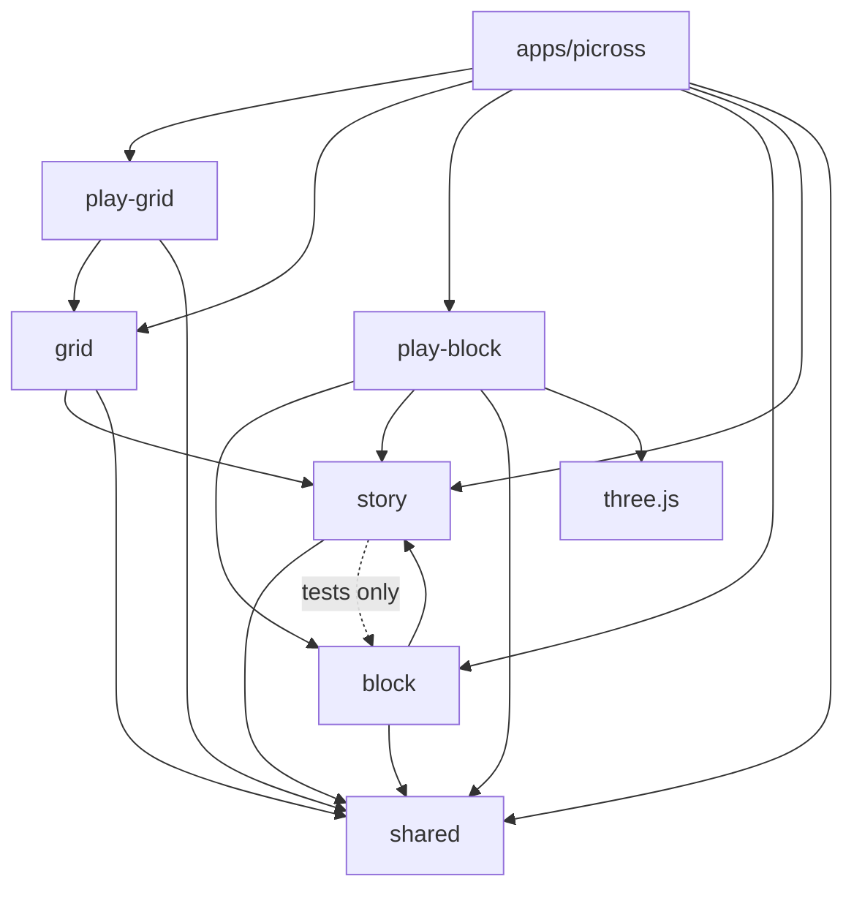

# Architecture

This repo holds two games in one app, and the packages they share. This page starts with
where every file lives and what it may import, then describes the 2D game. The 3D game,
Picross Cubed, has its own pages in [docs/cubed/](cubed/architecture.md) (below).

## Package map

The root is an npm workspace (`"workspaces": ["apps/*", "packages/*"]`): one app, six
packages, and the docs, CI, lint config and build scripts at the root. A package is plain
TypeScript with no build step. Its export map turns `@picross/<name>/<path>` into
`src/<path>.ts` (and `@picross/<name>/styles/<file>` into `src/styles/<file>`), so a file
keeps the path under `src/` that it had in the app it came from.

| Workspace             | Name                  | Owns                                                                                                                                                                                                                                                                | May import                                                                                                                      |
| --------------------- | --------------------- | ------------------------------------------------------------------------------------------------------------------------------------------------------------------------------------------------------------------------------------------------------------------- | ------------------------------------------------------------------------------------------------------------------------------- |
| `packages/shared`     | `@picross/shared`     | What both games use that isn't the story: tokens and base styles, the run, fight, dig, dialogue and art styles, sound, haptics, theme, `dom`, `motion`, `storage`, `random`, `prefs`, puzzle ids, the Home, mute and Flat \| Cubed buttons, the art and `ui/art.ts` | Only its own files                                                                                                              |
| `packages/story`      | `@picross/story`      | The story both games play: its JSON, loaders and checks, gadgets, the dialogue runner, fights over any board (`fight/`: `FightBoard`, `StoryBattle`, `FightRules`), and the scene player (`ui/`)                                                                    | shared, outside its `ui/` and `styles/`. Its `ui/` may use all of shared. Its tests may also use block                          |
| `packages/grid`       | `@picross/grid`       | The 2D rules and data: the engine, the puzzle format, the pack, sheets, ratings, murals, `Game` and the debug hooks. No DOM                                                                                                                                         | shared and story, outside their `ui/` and `styles/`                                                                             |
| `packages/play-grid`  | `@picross/play-grid`  | Playing a 2D board: the board view, input, zoom, the play screen and its `PlaySession`, `board.css` and `game.css`                                                                                                                                                  | grid and shared                                                                                                                 |
| `packages/block`      | `@picross/block`      | The 3D rules and data: the engine, the puzzle format, the pack, dioramas, the 3D story puzzles, `Game`, `Battle` and the story on blocks. No three.js                                                                                                               | shared and story, outside their `ui/` and `styles/`. Never three.js or play-block                                               |
| `packages/play-block` | `@picross/play-block` | Playing a block: the three.js view, input, the play, fight and editor screens, their styles, and the block e2e helpers                                                                                                                                              | block, shared, story and three.js                                                                                               |
| `apps/picross`        | `picross`             | The app, both games: routes, saves and settings, runs and fights, the daily, murals, badges, the editor, the debug panel and its scripts; Picross Cubed's screens, saves and settings in `src/cubed/` (under `#/cubed`)                                             | Every package. Only `src/routes.ts` reaches `src/cubed/`, with `import()`. Anything that pulls in three.js only with `import()` |

No package imports an app, and a relative import never leaves its package (the one
exception: story's art test reads shared's `public/art/`). Each package's rule is checked
twice: by `src/imports.test.ts` in the package (part of `npm test`), which reads every
import, `import()` and glob, and by its block in `eslint.config.js`
(`no-restricted-imports`, part of `npm run lint`). The app's rule is lint only, with
`no-restricted-syntax` catching `import()`. `npm run check:budget` checks that three.js
stays out of the first download and out of Cubed's routes: the play-block modules that use
it (the view, input and the screens built on them) load with `import()`.

Arrows point at what a workspace imports:



Each package has a README with its files and rules: [shared](../packages/shared/README.md),
[story](../packages/story/README.md), [grid](../packages/grid/README.md),
[play-grid](../packages/play-grid/README.md), [block](../packages/block/README.md) and
[play-block](../packages/play-block/README.md).

The 3D game's docs:

- [cubed/README.md](cubed/README.md): what it is, and the commands that are only its
- [cubed/architecture.md](cubed/architecture.md): its layers, the block, the view, its screens
- [cubed/how-to.md](cubed/how-to.md): add a puzzle, a color, a sound
- [cubed/story.md](cubed/story.md): the story on blocks, and the gate
- [cubed/roadmap.md](cubed/roadmap.md), [cubed/device-checklist.md](cubed/device-checklist.md)
  and [cubed/releases/](cubed/releases/)

## Directory map

Every package keeps its files under `src/`, at the same paths they had in the app they
came from. Tests sit next to the code they cover as `*.test.ts`.

```
apps/
  picross/                 The app: both games (workspace `picross`)
    index.html             Page shell; loads src/main.ts (its <title> and manifest link come from scripts/pwaPlugin.js)
    .env.development       VITE_DEBUG=1 for dev builds (the debug panel)
    public/
      favicon.svg
      icons/               The app icons in manifest.webmanifest (cubed.svg and the PNGs made from it)
      3d/                  Cubed's old address: index.html sends /3d/#/… to #/cubed/…, sw.js retires its old worker
    src/
      main.ts              Entry point: imports styles, applies theme, provides prefs, the hash router
      name.ts              GAME_NAME: the page title and the installed app's name
      routes.ts            The route table: which screen each hash opens (#/cubed/… is one entry)
      offline/             Offline play and updates (#160; see "Offline and updates")
        worker.ts          The service worker, bundled into sw.js by the build
        plan.ts            Its decisions: how each request is answered, caches, what an update keeps
        updates.ts         Registers it; "A new version is ready", off a board (register.ts starts it)
        boards.ts          isBoardRoute: the routes with a board, in both games
      ui/lifecycle.ts      onHide: Cubed's screens save when the page is hidden
      debug/panel.ts       Dev-only tools (#65), and panel.css; never in production builds (hooks are in grid)
      puzzles/             Content and its validation (the pack is in packages/grid)
        runs.ts            The story's encounters and jobs on a flat board: 2D puzzles and enemies
        chapters.ts        The story's chapters (#23), holding this game's jobs
        endless.ts         Endless mode: seeded encounter order, scaling, the run as a RunDef (#68)
        daily.ts           The Flat daily: the day's puzzle and turn (#69); date keys from shared
        tutorial.ts        How to play: its picture and steps, and what counts as a wrong move
        enemies.ts         Validates an enemy; lists its powers (startingPowers, phasePowers, enemyPowers)
        fightRatings.ts    Every fight's solver numbers on each board (#168), for fight-ratings.json
        ranks.ts           The rank ladder (#106)
        badges.ts          The badge catalog (#108)
        ids.test.ts        Every id in both games, qualified (grid:mug, block:mug), and the clashes
      game/                Game state and saves, no DOM (Game itself is in packages/grid)
        battle.ts          Enemy and BattleState (the 2D save), boardAt, carryHp; the rules' helpers, over the story battle
        battleCodec.ts     The 2D save ↔ the story battle's FightState, sparse and in place (#166)
        fight.ts           gridStep: one step of a 2D fight on the story battle, with the screen's events (#163)
        fightTrace.ts      A fight played headless through gridStep, for the tests only (#163)
        fightTraces.test.ts Golden traces of every 2D fight (#163)
        run.ts             RunState and its pure transitions
        progress.ts        Both games' free play: solve stats, boards, time (localStorage; progressFor(dim))
        runSave.ts         Both games' runs, seen scenes, job stats (localStorage)
        fightSave.ts       A fight's boards as the run saves them (one fight, an entry per board, #169)
        settings.ts        Both games' settings: mode, list filter/order, mute, haptics, dimDone… (localStorage)
        daily.ts           The one daily (#156): days solved, streak, best, today's board (localStorage)
        badges.ts          Badge rules and the earned badges (#108)
        fightBadges.ts     What a fight earns (fightAwards, earnFromFight): it reads the battle, so it's the run's
        rank.ts            Rank, worked out from solves (#106)
        saveMerge.ts       Merges two copies of a save (#97)
        migrate.ts         Save migrations, first thing at startup: the two games' saves (#155), their dailies (#156)
        legacyMerge.ts     That merge's rules, pure (tested on fixtures/legacy/, saves from real play)
        merging.ts         The pieces both merges are built from
        pickPuzzle.ts      The next unsolved puzzle (#114)
      ui/
        powers.ts          A one-line tip per enemy power (#79)
        screens/
          selectScreen.ts    Puzzle list, mode, stats, Settings link  (#/)
          freePlaySession.ts Free-play PlaySession: saves, best times, "Next" (#/play/<id>)
          daily.ts           The daily: its card on the list, and a Flat day's PlaySession (#/daily)
          mural.ts           Murals: the list section, a mural's tiles, playing a tile (#/mural/…)
          howToPlay.ts       Guided solve on a real board, then rules (#/how-to-play)
          editorScreen.ts    Puzzle authoring tool                   (#/editor)
          badges.ts          The badge shelf                         (#/badges)
          settings.ts        Both games' settings (#154)             (#/settings)
          run/               Runs, loaded on demand with the fight engine (#/run, #/run/play)
            index.ts         Run hub router
            banner.ts        The puzzle list's run banner (in the first download: reads only the save)
            shared.ts        Hub type, loadRun, mode picker, start buttons
            jobsBoard.ts     Jobs board (#47), grouped into chapters (#23)
            pathMap.ts       Path map, HP, gadget inventory
            results.ts       Results and sign-off
            encounter.ts     Plays the current encounter (a PlaySession), and switches board
            blockFight.ts    A boss's block phases, on play-block's fight screen (loaded on demand)
            dig.ts           Dig hooks: dirt board, header, the reveal
            rest.ts          Rest stop hooks: the countdown and the heal (#77)
            fight/           Fight hooks, one module per mechanic, showing gridStep's events:
              index.ts       Wires them into the session hooks (fightHooks), and runs what waits
              context.ts     Shared state: enemy, battle bar, battle, form, saving, step
              lines.ts       Completed lines: fog, scramble, armor, chip damage, the meters
              phases.ts      Phase changes: form, banner, more fog/scramble
              swaps.ts       The Mimic's swaps (wait for strokes to end)
              callOut.ts     Forged clues: the 🔍 Call out button and accusations
              ink.ts         Ink splashes from phases (#67)
              charge.ts      The ⚡ charge meter and its zaps (#67)
              turns.ts       The 🔃 turn meter: the board turns a quarter clockwise (#83)
              armorBack.ts   Armor hitting back every few lines (#116)
              tips.ts        Power tips: a card the first time you meet a power, and the ⓘ list (#79)
              gadgets.ts     The gadget tray
              hits.ts        Mistakes, shields, knockouts
              finisher.ts    The solved picture flying at the enemy
              fightHooks.test.ts The hooks in jsdom: every call they make, step by step (#163)
        components/
          battleBar.ts     Enemy/player HP, gadgets, armor, 🎭 forgeries, phase banner, hit effects
          listSection.ts   Collapsible puzzle list section
          rankCard.ts      Your rank and the way to your badges, on the list
          badge.ts         A badge's picture and tier rim
      styles/
        select.css         Puzzle list
        editor.css         Editor
        badges.css         Badges and the shelf
        switch.css         A boss switching board: the new board unfolds in
      cubed/               Picross Cubed, the 3D game (#/cubed/…; docs/cubed/), loaded on demand
        routes.ts          Its routes, from #/cubed on; hands over its settings while they're up
        href.ts            cubedHref(): every link between its screens
        game/              Views of the one save (progress, settings, runSave) and its daily
        ui/screens/        The list, free play, tutorial, how to play, shared puzzles, daily, dioramas
          story/           Story screens: jobs board, path map, encounters, digs, rests, results
        styles/select.css  The list
    e2e/                   Playwright browser tests (see docs/development.md)
      cubed/               Cubed's (helpers re-export play-block's), and its old /3d/ links
    scripts/
      puzzle-sheet.ts      Check, repair and export puzzle sheets (batches of drawings; see docs/how-to.md)
      rate-puzzles.ts      Writes packages/grid/src/puzzles/ratings.json (npm run rate:puzzles)
      rate-fights.ts       Writes src/puzzles/fight-ratings.json, both boards (npm run rate:fights)
      scopeByBoard.ts      PostCSS step: each game's screen styles apply only on its board
      pwa.ts               The web app manifest and the worker's precache list (pwaPlugin.js writes them)
      pwaPlugin.js         Vite plugin: the title, manifest.webmanifest and sw.js in each build
      script-review.ts     Build the script review site, serve it, and report notes (see docs/how-to.md)
      script-review/       Its page model, renderer, notes store, server, and browser assets
      screenshot.mjs       Screenshots a page of the running dev server
      icons.mjs            Makes public/icons/
packages/
  shared/                  What both games use (@picross/shared; its README)
    vite.js                sharedPublic(): serves public/ in dev, copies it into each build
    public/art/            Portraits (cast/), enemy sprites (enemies/), gadgets/, power icons/
    src/
      imports.test.ts      Nothing here imports from an app or another package
      engine/random.ts     Seeded random numbers and shuffles (endless, daily)
      puzzles/ids.ts       Puzzle ids with a dimension: qualify('grid', 'mug') is 'grid:mug' (#147)
      puzzles/days.ts      Day keys, and which board a day's daily is on (dailyDimension, #156)
      game/
        prefs.ts           The settings shared code reads (mute, haptics, contrast); each app's main.ts provides its own
        storage.ts         Safe localStorage JSON read/write
      ui/
        dom.ts             el(): create an element with props and children
        motion.ts          reducedMotion(), wait(), pause(), playOnce() for animations
        sound.ts           WebAudio-synthesized sound effects
        haptics.ts         Vibration on taps, lines, hits, and zaps (and the iOS switch fallback)
        theme.ts           Applies the high-contrast theme
        art.ts             Portrait, sprite and gadget images, with emoji stand-ins
        components/
          homeLink.ts      The Home button at the top of every screen
          muteButton.ts    Sound toggle
          gameSwitch.ts    The Flat | Cubed switch
      styles/
        tokens.css         Color tokens for light, dark, and high-contrast themes
        base.css           Page layout, buttons, toggles, segmented controls
        run.css            Run banner, jobs board, path map, results
        fight.css          Battle bar, gadgets, phase banner, armor, call-out
        dig.css            The dig's dirt board and reveal
        dialogue.css       Scene player
        art.css            Portraits, sprites and power icons
  story/                   The story both games play (@picross/story; its README)
    src/
      imports.test.ts      Imports only shared (pure outside ui/); never an app or a board package
      story.test.ts        The whole story reads, with no board
      boards.test.ts       The gate: the boards that can play each encounter and power
      game/dialogue.ts     Scene runner: current line or choices, advance, choose, flags
      fight/
        board.ts           FightBoard: what a fight needs of a board (#164)
        fightBoardContract.ts  The tests every FightBoard passes (each board's tests run them)
        battle.ts          StoryBattle and FightState: one battle over any board, in either order (#166)
        rules.ts           FightRules: where the boards' fights differ; BLOCK_RULES, GRID_RULES
        save.ts            FightSave: a fight as both games' runs save it, an entry per board (#169)
        battle.test.ts     Each rule's other value, powers from a pool, and the grid's order
      puzzles/
        runs.ts            Reads and checks encounters and jobs; each game passes its puzzle and enemy
        chapters.ts        Reads and checks chapters: jobs grouped into story chapters (#23)
        gadgets.ts         Gadget catalog: name, icon, description, effect
        scenes.ts          Loads and validates scenes/*.json (dialogue, #22)
        backdrops.ts       Loads and validates backdrops/*.json (where a scene happens)
        files/             Globs chapters, runs, encounters and run/ for the loaders
        encounters/*.json  Encounters: name, kind (fight/dig/rest), puzzle, enemy, boss, scene
        runs/*.json        Jobs: HP, encounters, gadgets, intro/outro, order, requires
        chapters/*.json    Chapters: title, order, blurb, jobs, opening scene
        run/*.json         Run-only puzzles (the sword, wrench, owl, pocket watch, ...)
        scenes/*.json      Scenes: backdrop, cast, nodes of lines, choices, and conditions
        backdrops/*.json   Backdrops: rows of # and ., drawn behind a scene's portraits
      ui/
        art.test.ts        Every sprite, portrait and gadget the story names has its art (in shared)
        screens/sceneScreen.ts  Plays a scene full screen        (#/scene/<id>)
        components/
          dialogue.ts      Scene player: stage of portraits, typed text box, choices, Skip
          backdrop.ts      Draws a backdrop as an SVG in the theme's color
  grid/                    The 2D rules and data, no DOM (@picross/grid; its README)
    src/
      imports.test.ts      Nothing here imports the page or an app
      node.test.ts         Every module loads and works in Node, with no DOM
      engine/              Pure puzzle logic
        board.ts           Cell states (Empty/Filled/Marked), Grid/Board/Solution, isSolved
        clues.ts           Clue derivation and per-clue "satisfied" check (clue dimming)
        history.ts         Change/Move types and the undo/redo History
        lines.ts           LineSet: sets of rows/columns (fog, scrambles, weak points)
        solver.ts          Line solver: uniqueness/no-guess check; fog and scramble aware; fightPasses
        swap.ts            Which two lines the Mimic swaps and wipes (#48)
        fakes.ts           The Forger's forged clues: a convincing wrong clue per line (#64)
        ink.ts             Where ink lands and how completed lines wash it off (#67)
        blast.ts           Where a bomb goes off and the cells it hits (#115)
        charge.ts          Which line a charging enemy goes live on (#67)
        transform.ts       The eight turns and flips of a grid (daily, #69); turning cells and lines (#83)
      game/game.ts         Game: board, history, mode/hearts, hints, clock, wipes; SavedBoard
      debug/hooks.ts       How the app's debug panel reaches into a board in play (#65)
      puzzles/
        format.ts          Puzzle file format, parse/validate, export helpers
        index.ts           Loads pack/*.json and story's run/*.json; the list sorts by size, then ORDER
        pack/*.json        Free-play puzzles (5×5 to 20×20): the starter set plus themed batches
        sheets/*.txt       The themed batches as drawings; apps/picross/scripts/puzzle-sheet.ts exports them
        pack.test.ts       Uniqueness check over every puzzle (npm run check:puzzles)
        ratings.json       Solver passes per puzzle (npm run rate:puzzles, #112)
        difficulty.ts      Difficulty bands from ratings.json
        murals.ts          Loads murals/*.json and splits each picture into tile puzzles (#24)
  play-grid/               Playing a 2D board (@picross/play-grid; its README)
    src/
      imports.test.ts      Nothing here imports from an app
      ui/
        format.ts          formatTime(), plural(), lineName()
        screens/gameScreen.ts  Play screen; PlaySession and its hooks  (#/play/<id>)
        board/
          boardView.ts     Clues + cells (ARIA grid), dimming, fog/scramble/weak points
          input.ts         Pointer input: click, right-click, drag strokes, touch
          keyboard.ts      Keyboard cursor and actions on a board
          zoom.ts          Pinch/wheel zoom and two-finger pan
          picture.ts       Pixel-art canvas of a solution
        components/
          endPanels.ts     Solved, out-of-hearts, and generic end panels
          hintMenu.ts      "Hint n/3" dropdown
          zoomBar.ts       − / level / + zoom buttons
      styles/
        board.css          Board, clues, cells, cursor, fog/scramble/weak-point clues
        game.css           Play screen: toolbar, hint menu, tools and zoom row, end states
  block/                   The 3D rules and data, no three.js (@picross/block; its README)
    scripts/
      puzzles.ts           Checks the pack and writes hide and passes (npm -w packages/block run puzzles)
      bench.ts             Times hiding and solving a 10×10×10 block
    src/
      imports.test.ts      Only shared and story outside ui/; never three.js, play-block or an app
      engine/              volume.ts (the block and its lines), clues.ts, solver.ts
      game/                game.ts (Game, Mode, SavedBoard), battle.ts (Battle: StoryBattle on a block), clock.ts;
                           battleTraces.test.ts (golden traces of every fight, #168)
      story/               data.ts (the story fitted to blocks, storyIssues), powers.ts (tips)
      puzzles/
        format.ts          The block puzzle format and COLORS
        index.ts           Loads the pack
        hide.ts            Picks the clues a puzzle hides
        difficulty.ts      Bands by passes
        daily.ts, transform.ts  The daily: a pack puzzle turned or mirrored
        dailyCycle.ts      Which puzzle and turn each Cubed day is: every one before a repeat (#156)
        diorama.ts, dioramas.ts  Dioramas: big blocks split into tile puzzles
        sheet.ts           The sheet format (layers side by side)
        check.ts, draft.ts, share.ts  The editor's checks, drafts and share codes
        pack/*.json        Free-play puzzles
        dioramas/*.json    Dioramas
        story/*.json       A 3D puzzle per story encounter, named after its 2D puzzle
        sheets/*.txt       Batches as drawings (sheets/story/ for the story puzzles)
        pack.test.ts       Every puzzle solves from the clues it shows
  play-block/              Playing a block (@picross/play-block; its README)
    e2e/helpers.ts         Block helpers for both games' browser tests
    src/
      imports.test.ts      Only block, shared, story and three.js; never an app
      ui/
        board/             blockView.ts (three.js scene), atlas.ts, input.ts, thumbnail.ts
        screens/play.ts    The play controller and PlayHooks
        screens/story/     fight.ts (a fight on a block, FightRun), kind.ts
        screens/editor/    editorScreen.ts and checkWorker.ts
        components/hintMenu.ts, format.ts, prefs.ts (providePlayPrefs), tokens.ts
      styles/              voxels.css (shape colors), game.css, story.css, editor.css
docs/                      These docs; docs/cubed/ for the 3D game
scripts/
  check-prod-bundle.sh     npm run check:bundle: no debug code in dist/
  check-bundle-budget.mjs  npm run check:budget: the first download's size, and no three.js in it or Cubed's routes
  bundle-budget.json       The budgets
  deploy-azure.sh          Upload a build to the Azure static website
  setup-azure-deploy.sh    One-time Azure + GitHub OIDC setup for the release pipeline
  art-clean.py             Cleans approved art from docs/art/incoming
eslint.config.js           Lint for every workspace, with the import rules
.github/workflows/
  ci.yml                   Lint, test, build, check:bundle, check:budget, e2e; deploy main to Pages
  deploy-azure.yml         Deploy a published release to Azure
.claude/launch.json        Dev server config for Claude Code's preview
```

## The 2D game

The 2D game is a single-page app in plain TypeScript with no UI framework. Screens build
DOM nodes with a small `el()` helper, and the code is split into four layers. Each layer
only imports from the layers above it in this list:

| Layer   | Folder     | Knows about the DOM? | Job                                                             |
| ------- | ---------- | -------------------- | --------------------------------------------------------------- |
| Engine  | `engine/`  | No                   | Pure puzzle logic: grids, clues, undo history, the line solver  |
| Puzzles | `puzzles/` | No                   | The puzzle file format and the built-in pack                    |
| Game    | `game/`    | No (uses storage)    | A puzzle in play (rules, hearts, hints, clock), saves, settings |
| UI      | `ui/`      | Yes                  | Screens, the board view, input, sound, and components           |

Keep rules and state in `engine/` and `game/`, where they can be unit tested without a
browser. The UI should only translate events into `Game` calls and redraw.

The layers span the app and the packages. The 2D core of the first three (the engine, the
format and pack, and `Game`) is `packages/grid`, which can't import the UI and runs its
tests in Node. The board view, input and play screen are `packages/play-grid`. The story's
data, loaders and scene player are `packages/story`. Fights, runs, saves and the other
screens stay in `apps/picross` and reach the play screen through its `PlaySession`.

The rest of this page names files by their path under `src/`. Look a path up in the
directory map above to find which workspace it's in: `engine/` and `game/game.ts` are in
grid, `ui/board/` and `ui/screens/gameScreen.ts` in play-grid, the story JSON in story,
`styles/tokens.css` in shared, and the rest in `apps/picross`.

## Core data model

- **`Cell`** (`engine/board.ts`) is `Empty = 0`, `Filled = 1`, or `Marked = 2`.
- **`Grid<T>`** is `{ width, height, cells: T[] }`, stored row-major (`index = r * width + c`).
  A `Board` is a `Grid<Cell>` (the player's marks) and a `Solution` is a `Grid<boolean>`.
- **`Puzzle`** (`puzzles/format.ts`) bundles `id`, `name`, size, `solution`, and its derived
  `clues` (`{ rows: number[][], cols: number[][] }`). An empty line has `[]` as its clue, and
  the board shows it as `0`.
- **`Change`** is `{ index, from, to }`, and a **`Move`** is `Change[]`. A drag stroke, a
  reset, or a hint is one move, so it undoes in one step.

## How a move flows

```
pointer/touch ─▶ ui/board/input.ts ──┐
keyboard ──────▶ ui/board/keyboard.ts ┼─▶ gameScreen play() ─▶ Game.preview()  (applies, checks hearts)
hint menu ─────▶ gameScreen useHint() ┘                    └─▶ view.update()   (redraw, clue dimming)
                                         stroke ends ──────▶ Game.commit()     (history + solved check)
                                                           └─▶ refresh()       (save, toolbar, panels)
```

1. `input.ts` turns a pointer down into a **stroke**. A stroke only changes cells in the
   same state as the cell it started on, and its first move locks it to a row or column. As
   the pointer moves, it calls `onPreview` with the newly covered cells.
2. `gameScreen.play()` passes them to `Game.preview()`. That applies them right away (live
   drag feedback) and, in Hearts mode, turns a wrong fill into an X, costs a heart, and tells
   the input layer to end the stroke. Sounds, haptics (one tap per stroke), error flashes,
   and line-complete effects happen here too.
3. When the stroke ends, `Game.commit()` records the changes as one undoable move and
   rechecks whether the puzzle is solved.
4. `refresh()` saves progress, updates the toolbar and hearts, and shows the solved or
   failed panel when needed.

Keyboard actions and hints go through the same `play` → `commit` → `refresh` path, so the
rules stay identical across input methods.

## State and persistence

All saved data lives in `localStorage`, read once at startup and written on change. Since
the save merge (#155) the 2D game and Picross Cubed share one save:

| Key                | Module                       | Contents                                                                                                                                                                                                                                                         |
| ------------------ | ---------------------------- | ---------------------------------------------------------------------------------------------------------------------------------------------------------------------------------------------------------------------------------------------------------------- |
| `picross:v2`       | `game/progress.ts`           | Both games' free play, by qualified id (`grid:mug`, `block:mug`): per-puzzle stats (`clean` solves for Cubed), in-progress boards, time played per dimension (`time.grid`, `time.block`), Cubed's editor play-tests                                              |
| `picross:run`      | `game/runSave.ts`            | The 2D run in progress (`current`, with the current encounter's board, or a fight's `fight`), Cubed's (`block.current`, its own RunState, its fight's the same way), the scenes and tips seen, and job stats from both (`wonOn`: the boards a job's been won on) |
| `picross:settings` | `game/settings.ts`           | `mode` (default for new runs), `listFilter`, `listOrder`, `listDifficulty`, `collapsedSections`, `muted`, `highContrast`, `haptics`, and Cubed's `dimDone` and `cubedTutorialDone`, and `freePlayTab` (#153)                                                     |
| `picross:badges`   | `game/badges.ts`             | Both games' earned badges (Cubed's as `block-<id>`, #157): each one's best tier and the date first earned, and `seen`, how far each had got when the shelf was last open                                                                                         |
| `picross:daily2`   | `game/daily.ts`              | The one daily (#156): every day solved (`days`: its board, and best time if kept), the streak as of `lastSolved`, the best streak, the solve count, and today's board (with its board, `dimension`)                                                              |
| `picross:editor`   | `ui/screens/editorScreen.ts` | The editor's current drawing                                                                                                                                                                                                                                     |
| `picross:game`     | `gameSwitch.ts` (shared)     | The Flat \| Cubed switch's last pick                                                                                                                                                                                                                             |
| `picross:save`     | `game/migrate.ts`            | `{ version, mergedAt }`: the migrations run so far                                                                                                                                                                                                               |
| `picross:premerge` | `game/migrate.ts`            | The text of `picross:run` and `picross:settings` from before the merge rewrote them                                                                                                                                                                              |
| `picross:daily`    | (old)                        | The 2D game's daily before #156; read only by the migration                                                                                                                                                                                                      |
| `picross3d:badges` | (old)                        | Cubed's badge tiers seen before #157; read only by the migration                                                                                                                                                                                                 |

Free play's size filter and its Both boards toggle are `listSize` and `pickBoth` there too.

Cubed's `cubed/game/progress.ts`, `runSave.ts`, `settings.ts` and `daily.ts` are views of the
first three and the daily on the `block` side (`progressFor('block')`, `block` in the run save, `tutorialDone` read
from `cubedTutorialDone`), so Cubed's screens didn't change. A job is the same job on either
board, so the job stats and the scenes seen are both games', while each game keeps its own
run in progress, and either can be continued while the other waits.

**The settings screen** (#154) at `#/settings` (`ui/screens/settings.ts`), linked from both
games' lists (`ui/components/settingsLink.ts`), shows the one `picross:settings`:

- **General:** Sound (`muted`), Haptics (on a touch screen that can buzz), High contrast and
  the mode (Relaxed or Hearts, which the lists can change too). Light or dark, and reduced
  motion, follow the device; a line on the screen says so.
- **Cubed:** Fade finished clues (`dimDone`), and a link to replay the block tutorial.
- **No Flat group:** the 2D game has no settings of its own beyond its list's order, filters
  and closed sections, which stay on its list.

The switches are native checkboxes with `role="switch"`, and the mode is a pair of radio
buttons, so the keyboard works as usual. Since there's one save, a change is the same change
everywhere: the boards read sound, contrast and haptics through `providePrefs` and
`dimDone` through `providePlayPrefs` as they draw, so a board you go back to (a fight on its
block phase too) has the new value. The lists' old sound, contrast, haptics and fading
buttons moved here; each board keeps its speaker button. `picross3d:settings` is read only by
the migration (a test in `migrate.test.ts` checks).

A `block:` id in `picross:v2` always means Cubed's pack or a diorama tile. Four 3D story
puzzles share ids with the pack (`block:bat`), but story boards are saved in the run, never
here (only Cubed's free-play and diorama screens record solves).

**The first-launch merge** (#155). `game/migrate.ts` runs versioned steps, each safe to run
again, and writes `picross:save` after each. `main.ts` imports it first, and it imports no
store module, because the stores read `localStorage` as soon as they're imported. Step 1
merges the two old games' saves with `game/legacyMerge.ts` (pure, tested on fixtures from
real play in `game/fixtures/legacy/`):

- **Free play:** `picross:v1` and `picross3d:v1` into `picross:v2`, ids qualified.
- **Story:** Cubed's `picross3d:run` into `picross:run`: its run under `block` as it was,
  scenes and tips as one set, and job stats added up (plays, wins, Hits-on wins), with the
  better best HP and `wonOn` for where each was won.
- **Settings:** `picross3d:settings` into `picross:settings`. A setting both games have takes
  the 2D game's value where its key had one, and Cubed's otherwise. `picross:game` becomes
  `freePlayTab`.
- **Badges** are step 3's (below).

Step 2 (#156) merges the two dailies into the one daily, `picross:daily2`, with
`mergeDailies` in `legacyMerge.ts`. It runs for a save step 1 already merged too, which has
played both dailies on their old keys since:

- **Days:** Cubed's are every day it has a time for. The 2D game kept no list, only its
  streak as of `lastSolved`, so its days are that streak's: `lastSolved` and the `streak − 1`
  days before it. A day either game solved counts; one solved in both keeps the board that
  day's one daily is on.
- **Streak and best:** the streak is the run of days in a row ending at the last day solved,
  kept as of that day; whether it's still alive is decided on the day, as before (the last
  solve was today or yesterday). The best is the highest of both games' bests and every run
  in the days.
- **Solves** add up: the 2D game's count and Cubed's days (a day solved in both was two
  puzzles), so rank keeps every daily it counted.
- **A board in progress** comes along only if the one daily would open it: the 2D game's,
  for a Flat day after its last solve. Cubed's never does, since Cubed's days have new
  puzzles now.

Step 3 (#157) carries over the badges each player has already seen, so the one shelf doesn't
mark them "New!": Cubed's tiers seen (`picross3d:badges`) as `block-<id>` levels in
`picross:badges.seen`, and every 2D badge already earned. Levels seen only go up, so it's safe
to run again. Cubed's badges themselves aren't copied: `syncBadges` earns them from the merged
saves at startup, at the tier Cubed showed or better (`badgeRecount.test.ts` checks the
fixtures).

Like step 1's, it reads only keys nothing else writes, and writes a new key, so it's safe to
run again and `picross:daily` and `picross3d:daily` stay for a rollback.

Nothing deletes a key. `picross:v1`, `picross:daily` and every `picross3d:` key stay as they were, for a
rollback, and only the migration reads them. The two keys it rewrites keep their old text in
`picross:premerge`, which is also what a step reads if it runs again after being cut short,
so Cubed's jobs never count twice.

A fight in progress saves as one `fight` on the run (#169, `@picross/story/fight/save`):
`{ v: 2, boards: { flat?, block? } }`, an entry for each board the fight has used, each with
that board's marks and battle (`board`, `battle`) in that board's own format, exactly as
before. Cubed's run (`block.current` in the same `picross:run`) saves its fights the same
way, as the block's entry. Which board is showing isn't saved: it's the board the fight's
phase says (`boardAt`). The game holds the run as it always did (`board`, `battle`,
`block`); the run save moves a fight into `fight` as it writes (`saveFight`,
`game/fightSave.ts`, and Cubed's own) and back as it reads (`loadFight`), and a run saved
before #169, with those fields on the run, loads as it is, forever. Those fields beside a
`fight` can only have been written by an older version since, so they win, whole. Digs and
rests keep their board in `board`.

`game/saveMerge.ts` combines two copies of a save (#97), so cross-device sync never has to
ask which one to keep. It's a pure function with one rule per kind of data: bests and
unlocks are never lost, the run is taken whole from whichever side changed it last
(`currentUpdatedAt`), and fields it doesn't recognize pass through, so an older client
can't delete newer data. Counts take the higher side rather than adding up (unlike the
first-launch merge, which adds up two different games), because adding would double-count
on every sync, so playing on two devices between syncs can undercount
`solves`, `plays` and `totalTime`. Settings and the editor's drawing aren't merged, since
they belong to one device.

`storage.ts` falls back to defaults if storage is blocked or holds bad JSON, so the game
still works in private browsing. To reset during development, clear the site's local
storage in devtools.

A saved board stores its cells as a digit string (`"0120…"`) plus elapsed time, mode,
hearts, and hints used. A puzzle keeps the mode it was started in. Solving it clears the
saved board, and failing in Hearts mode discards it.

### Overtime

A job can have a harder replay (#113): a run file with `overtimeOf` and `requires` set to
that job. It stays out of `runs`, so it doesn't count as a job on the board or feed Endless,
and it appears on the job's card once the job is cleared. It always plays with Hits on and
saves its results under its own id. Its fights are separate `overtime-*` encounter files
with extra powers, so story versions never change, and tests hold them to the same rules:
solvable without guessing with every power applied, and weak points reachable early.

Every job has one except Closing Time, which is left out with the Curator on purpose. The
Night Shift was the pilot. The powers each enemy gains are picked by hand and ramp in story
order, so later jobs stack more of them on each enemy.

### Boss fights

A standalone boss fight is a one-encounter run file with `bossOf` and `requires` set to the
job that unlocks it. Like Overtime it stays out of `runs` (no chapter, no Endless pool) and
shows on that job's card once the job is cleared, under its own heading with a "Start boss
fight" button. It plays in the player's chosen mode and saves results under its own id.
The Weathervane (`weathervane-boss`, the board-turning foe from #83) is the first,
unlocked by Summit Station.

### Difficulty ratings

Each pack puzzle is rated (#112) from how many passes a line solver needs on its plain
clues (`linePasses` in `engine/solver.ts`), sorted into bands in `puzzles/difficulty.ts`.
Rating the whole pack takes long enough to stall the list on a phone, so the numbers are
saved in `puzzles/ratings.json` by `npm run rate:puzzles`, and a test fails if they fall out
of step with the puzzles. Passes only approximate how hard a puzzle feels, and enemy powers
aren't counted. Fights are rated separately, with their powers, in the app's
`puzzles/fight-ratings.json` (see [Difficulty](#difficulty)). Murals aren't rated, and a
difficulty filter leaves them out.

### Rank and badges

**Rank** (#106) measures how much you've solved. `game/rank.ts` works it out from existing
solves, so it's never stored and old saves need no migration: each pack puzzle counts once
by size, plus mural tiles and dailies. Time and mode never count. Thresholds in
`puzzles/ranks.ts` stay fixed, so new puzzles can't lower anyone's rank. Both packs count
(#157): a block by its longest side, a diorama piece like a mural tile.

**The 3D pack's catalog.** Rank and the badges are on the first screen, and the 3D pack (every
block's layers and clues) isn't in the first download (`npm run check:budget`). So
`npm -w packages/block run puzzles` also writes `packages/block/src/puzzles/catalog.json`:
each pack puzzle's longest side, and the diorama pieces' ids (about 1.9 kB, 0.7 kB
gzipped). `catalog.test.ts` there fails when it's out of date, like `ratings.json`'s test.

**Badges** (#108) record how you did something, which can't be worked out afterward, so
they're saved when earned. `puzzles/badges.ts` is the catalog and `game/badges.ts` holds
the rules. Tiers only go up, and a badge keeps the date it was first earned: `earn` skips
an award at or below what's saved, so nobody ever loses a badge or a tier.

- **One shelf for both boards** (#157), at `#/badges`, grouped: the story (job badges by
  chapter, then Odd Jobber and Overtime), Free play · Flat, Free play · Cubed, Daily,
  Endless, Know-how, Bad days, and Both boards. `#/cubed/badges` moves there.
- **Count badges** (`kind: 'count'`) have steps: three for bronze, silver and gold, or one
  for a badge without tiers. `countOf` works each count out from both boards' saves.
  Cubed's nine badges are count badges with `block-` in front of their old ids, worked out
  as Cubed did (its "Regular" is now "Clocking In", since the 2D game has a Regular).
  The story ones count the 2D game's chapters and jobs, which a test checks are the ones
  Cubed plays. The Flat board got three of its own (Square Deal, Wall to Wall, Signed in
  the Corner), and both boards three (Fifty-Fifty, Second Opinion from `JobStats.wonOn`,
  Flat-Packed from the pictures in both packs).
- **New:** `seen` in the save holds each badge's level (`badgeLevel`: 1 earned or bronze,
  2 silver, 3 gold) as of the last time the shelf was open. A badge further on shows "New!"
  there, and the links to the shelf count them ("Badges (2 new)"). Opening the shelf marks
  them seen. Migration step 3 sets `seen` from Cubed's `picross3d:badges` and the 2D
  badges already earned (the 2D game showed each as it was earned).
- **When they're earned:** `syncBadges` at startup and when the shelf opens (no date, for
  older saves and anything a screen didn't award); `earnFromStats` after a solve on either
  board, a daily, a Cubed run and a play-test (dated, and said on the end panel), and
  `earnFromRun` / `earnFromFight` in the 2D game's story. `earnFromFight` is in
  `game/fightBadges.ts`, apart from the rest, because it reads the fight's battle: only the
  run screens use it, and they load with the fight engine (`import()`, `routes.ts`).

- **How a run went** (#107): a fight keeps its counts in `BattleState.counts`, which roll
  into `RunState.tally` when the fight is won. Count each thing at its cause rather than
  in `takeHit`, which handles wrong fills, wrong accusations and zaps alike and returns
  early when a patch kit blocks the hit. A blocked wrong fill still counts.
- **Older saves:** `syncBadges` runs at startup and awards what the stats prove, without
  dates. Runs from before the tally can't prove they were clean, so they can't earn gold.
- **`bestHp`** only means something alongside `hitsOnWins`, because older saves may hold a
  Relaxed run's HP there, and enemies can't hurt you in Relaxed.
- **Spoilers:** a badge with `opensWith` shows as "???" on the shelf until that job is open.

## Routing and screens

`main.ts` routes on the URL hash, with the table in `routes.ts`: each entry has a `match`
(what the screen needs from the hash, or nothing) and a `render`, and the first that matches
draws. A new screen is one entry. Hash routing works on GitHub Pages without server config.

| Hash               | Screen                                                                                            |
| ------------------ | ------------------------------------------------------------------------------------------------- |
| `#/`               | `renderSelectScreen` (also the fallback for unknown hashes)                                       |
| `#/play/<id>`      | `renderGameScreen` for a pack puzzle                                                              |
| `#/how-to-play`    | `renderHowToPlay`: the interactive tutorial and the rules                                         |
| `#/editor`         | `renderEditorScreen`                                                                              |
| `#/badges`         | `renderBadgesScreen`: the badge shelf (#109)                                                      |
| `#/settings`       | `renderSettingsScreen`: both games' settings (#154), loaded with `lazy`                           |
| `#/run`            | `renderRunScreen`: start panel, path map, or results                                              |
| `#/scene/<id>`     | `renderSceneScreen`: preview a scene (Replay at the end)                                          |
| `#/run/play`       | `renderRunEncounter`: the current encounter's puzzle                                              |
| `#/daily`          | Today's daily (#69, #156): `renderDailyScreen` on a Flat day, Cubed's daily screen on a Cubed day |
| `#/mural/<id>`     | `renderMuralScreen`: a mural's tiles, or the finished picture (#24)                               |
| `#/mural/<id>/<n>` | `renderMuralTile`: tile n of a mural                                                              |
| `#/free/flat`      | `renderFreePlay`: free play's Flat tab, the 2D pack (#153, [The puzzle list](#the-puzzle-list))   |
| `#/free/cubed`     | `renderFreePlay`: free play's Cubed tab, Cubed's list (a Cubed route)                             |
| `#/free`           | Free play's last tab (`freePlayTab`): `main.ts` swaps the hash (`movedTo`)                        |
| `#/cubed/…`        | Picross Cubed (`cubed/routes.ts`; its routes are in [docs/cubed/](cubed/architecture.md#screens)) |

Each screen replaces `#app`'s children. A screen that adds global listeners or timers
returns a cleanup function, which the router calls before rendering the next screen. The
game screen does this for its clock and its Ctrl+Z handler. A screen that loads its module
first (anything with a block) goes through `lazy`, which draws it only if no other route
has opened meanwhile.

**Picross Cubed** is one entry, `#/cubed/…`, which loads `cubed/routes.ts` with `import()`:
Cubed's list, its pack and its styles aren't in the first download, and three.js waits for a
screen with a block (`npm run check:budget` checks both, and a lint rule keeps the rest of
`src/` from importing `cubed/`). Its routes are marked `game: 'cubed'`, and the router then:

- sets `<html data-board="block">`, so Cubed's screen styles apply and this game's don't (see
  [Switching board](#switching-board-the-curator)), and clears the screen when you cross
  between the games, so one game's screen is never drawn with the other's styles;
- hands shared code Cubed's view of the settings (`cubed/game/settings.ts`, the same save
  since #155) while Cubed's routes are up, and this game's again after;
- runs Cubed's page lifecycle: its screens save on `visibilitychange` through
  `ui/lifecycle.ts`, tear down on `pagehide`, and draw again when the page comes back from
  the browser's cache.

Cubed's screens link to each other with `cubedHref('/play/mug')` (`cubed/href.ts`), and the
package screens it uses take their links as options (`home` on play-block's play and fight
screens and `homeLink()`, `sharedHref` on its editor). `#/` or no hash opens Cubed's list
when it was the game played last (the Flat | Cubed switch remembers). Cubed used to be its
own app at `/3d/`: `public/3d/index.html` sends each old link to the same screen here
(`/3d/#/play/mug` to `#/cubed/play/mug`; scenes to `#/scene/<id>`), and `public/3d/sw.js`
replaces its old service worker with one that deletes the old cache and unregisters.

## Offline and updates

The game installs as an app and plays offline (#160). A build (`npm run build`, and
`build:dev` for GitHub Pages) writes two files at the site's root, from
`scripts/pwaPlugin.js` (its decisions are in `scripts/pwa.ts`, with tests):

- **`manifest.webmanifest`:** the name (`GAME_NAME` in `src/name.ts`, which is also the
  page's `<title>`), the icons in `public/icons/` (192 and 512 px, and a maskable 512),
  `start_url` and `scope` `./`, standalone, in the page color (`--bg` from tokens.css).
- **`sw.js`:** `src/offline/worker.ts`, bundled with the build's file lists and a version
  (a hash of the files, so an unchanged build is an unchanged worker).

**What's cached.** Installing precaches the app shell: `index.html`, the entry chunk with its
static imports and CSS (the 2D game, its pack and the story), Cubed's routes chunk with its
static imports (its list and pack), and every file outside `assets/` (the art, the icons,
`3d/index.html`), about 1.9 MB. The lazy chunks the entry loads that bring three.js aren't,
and nor is anything only they load (play-block's screens, the block fight): the first block
the player opens caches three.js and all of them, so after one block every block screen
opens offline. Each version has its own cache (`picross-app-<version>`), and when a new
version installs it carries the lazy files over, copying the unchanged ones and downloading
the changed. Taking over deletes the old caches.

**How requests are answered** (`strategy` in `plan.ts`): a page load goes to the network
first and opens the cached `index.html` when that fails or takes over 3 seconds (the app
routes on the hash, so one page is all of it; `/3d/` opens its cached redirect page the same
way). Precached files come from the cache, other files under `assets/` from the cache once
used, and anything else (Google Fonts, the workers themselves, `.vite/`) as if there were no
worker. The worker's scope is the site's root, which also covers `/3d/`: a player who still
has Cubed's old worker there has a registration with the narrower scope, which keeps
`/3d/` until the kill switch at `/3d/sw.js` unregisters it.

**Updates.** A new version installs in the background and waits (no `skipWaiting` on
install). `src/offline/updates.ts` watches for it, and when the player isn't at a board
(`isBoardRoute` in `boards.ts`: a puzzle, a fight, the daily, a mural tile or an editor, in
either game) shows "A new version is ready · Reload". Reload posts `SKIP_WAITING`; the new
worker takes over, and the page reloads on `controllerchange`. At a board the bar stays away
and comes back when they leave, so the game never reloads mid-fight; if another tab hands
over first, this one reloads too, again only off a board. The page asks for an update
whenever it comes back to the front, for an installed game left open for days.

**Where it registers.** `src/offline/register.ts` (one import in `main.ts`) registers
`./sw.js` once the page has loaded, in any build (the plugin sets `import.meta.env.VITE_SW`)
and never under `npm run dev`. GitHub Pages, the dev site, gets the worker too, so offline
play and updates can be tried there before a release. Browser tests block service workers,
except `e2e/offline.spec.ts`.

## Board rendering

`boardView.ts` builds one CSS grid: a corner, a header row of column clues, then one row
per board row (row clues, then cells). The rows are `role="row"` wrappers with
`display: contents`, so screen readers see a proper ARIA grid without changing the layout.
Cell size is a single CSS formula (`--cell` in `styles/board.css`) that fits the board to
the viewport and multiplies by `--zoom`.

`view.update(board)` redraws cell classes and clue dimming, and returns any lines that just
became complete. One-shot effects (`flashLine`, `flashError`, `flashHint`) add a class for
about a second. They animate a `::after` overlay so they never restart the cell's own fill
animation.

## Styling and themes

Every color, and the font (Rubik, #25), is a CSS custom property in `styles/tokens.css`.
[Art direction](art-direction.md) says what each one is for. The tokens are redefined for
dark mode (`prefers-color-scheme`) and for high contrast (`:root[data-contrast='high']`,
set by `ui/theme.ts`). Use tokens rather than hard-coded colors so all three themes keep
working. Shared button styles live in `base.css`: `.button`, `.ghost`, `.primary`, a
`.toggle` that shows `aria-pressed`, and `.segmented` button groups.

Both games' styles are in the app, and some class names mean different things in each
(`.puzzle-card`, `.stage`, `.topbar`). So each game's own screen styles apply only on its
board (`scripts/scopeByBoard.ts`): Cubed's under `<html data-board="block">`, which the
router sets on `#/cubed/…`, and this game's without it. The shared ones (tokens, base, run,
fight, dig, dialogue, art) apply everywhere, and so does the settings screen's
(`styles/settings.css`), which is both games'. See [Switching board](#switching-board-the-curator).
A screen both games show is unscoped too: free play's tabs, filters and pickers
(`styles/freePlay.css`) look the same on the Flat tab and on the Cubed tab, where
`data-board="block"` is up.

## Play sessions: free play vs. runs

`renderGameScreen(app, puzzle, session)` doesn't know where a puzzle came from. A
`PlaySession` (defined in `gameScreen.ts`) supplies:

- the back link and the title shown before the puzzle is solved
- the mistake mode
- the saved board, and `save(board | null)` to save or clear it
- `complete(game)`, which records the solve and returns the solved panel's note and
  buttons
- optional encounter hooks: a `header` above the board, a `theme` (adds `theme-<name>` to
  the screen for restyling), `onLinesComplete`, `onMistake`,
  `ended()` to stop play early (e.g. knocked out), and `celebrate()` to animate before the
  solved panel appears
- `onBoard(view)`, called once with the board view before play (fights use it to fog
  clues)

`freePlaySession(puzzle)` is the default. It saves to `progress.ts` and records best
times. A run encounter (`screens/run/encounter.ts`) saves the board into the run state and clears the
encounter instead, so run solves never touch free-play stats. Fights (`run/fight/`)
and digs (`run/dig.ts`) plug in through the optional hooks, so the game screen has no
special cases for encounter types.

## The daily puzzle

A card at the top of each game's list opens `#/daily` (#69): one puzzle a day, the same
for everyone on the same local date. Since #156 there's one daily for both games, with one
streak, on the two boards by turns.

- **The board:** `dailyDimension` (`packages/shared/src/puzzles/days.ts`) puts the daily on
  Flat on odd days since the epoch and Cubed on even ones (by `dayNumber`, never the day of
  the month, which would put two Flat days together after a 31st). One a day, rather than
  both: the 3D one is slower, and two would double the daily. The route picks the screen:
  a Flat day draws `renderDailyScreen`, and a Cubed day loads Cubed's daily screen with
  `import()` (`routes.ts`), so three.js stays out of the first download. `#/cubed/daily`,
  the old link, moves to `#/daily` (`movedTo`, before routing), and so does `/3d/#/daily`.
  Both lists' cards say which board today's is ("Today: Cubed"); the 2D list doesn't draw a
  Cubed day's block, so it doesn't load Cubed's pack.
- **A Flat day's pick:** `puzzles/daily.ts` takes every pack puzzle 15×15 or bigger (from
  `packInOrder`, so re-sorting the list doesn't move anyone's daily) in all eight
  turns and flips (`engine/transform.ts`). That's 213 × 8 = 1704 boards, shuffled with a
  fixed seed into a cycle by calendar day, so nothing repeats until the cycle runs out.
  Flat days play exactly what they did before #156; Cubed's days just skip their turn.
  Turning or flipping keeps a puzzle uniquely solvable, since its clues just move or
  reverse. The tests solve a sample of days to check.
- **A Cubed day's pick:** `packages/block/src/puzzles/dailyCycle.ts` runs Cubed day number
  `Math.floor(dayNumber / 2)` through a cycle of every pool puzzle (4 or more on the longest
  side) in all eight turns and mirrors, the same cycle over and over, so no puzzle and turn
  repeats within any stretch of that many Cubed days. The cycle is eight rounds of the
  whole pool, each in a fixed shuffle, so a block comes back only in the next round, in a
  turn it hasn't had, and never two Cubed days running. (Before #156 Cubed picked by a hash
  of the date, which repeated.) A test checks the next 365 days: the boards alternate, and
  neither repeats.
- **Hidden until solved:** the board is named "Daily puzzle". The end panel and the card
  then say which pack puzzle it was and how it was turned.
- **Saves:** the one daily's save (`picross:daily2`, `game/daily.ts`; Cubed's
  `cubed/game/daily.ts` is a view of it) is apart from free-play stats. It holds every day
  solved (its board, and its best time), the streak, the best streak and the solve count,
  and today's board in progress with the board it's on. A streak counts while the last
  solve was today or yesterday, on either board, and shows 0 once a day is missed. Both
  games' daily badges and rank read it, so they count both boards' days.

## The puzzle list

`selectScreen.ts` groups the pack by size, smallest first. `puzzles` is sorted the same way, so
card numbers run in display order and "Next" walks from simple to hard. Murals sit above the
sizes in one row that scrolls sideways, so they stay easy to find without pushing the first
puzzles down the page.

The All / Not completed / Completed filter is `listFilter` in the settings, so it survives
a visit to a puzzle. A puzzle in progress counts as not completed, and so does a mural until
its last tile is solved. A size with nothing to show disappears; its heading's count always
covers the whole size.

`puzzleList.ts` draws the list (murals, then the sizes) for both the home list and free play's
Flat tab. Thumbnails of solved puzzles draw when their card nears the screen
(`components/lazyThumb.ts`, an `IntersectionObserver`; cards have a fixed-height `.thumb`, so
nothing moves when one draws). Cubed's list does the same, outlines and all.

**Free play** (#153, `ui/screens/freePlay.ts`) is both packs in one screen, a tab each:
`#/free/flat` is the 2D pack with its murals, `#/free/cubed` Cubed's list with its dioramas
(`cubed/ui/screens/selectScreen.ts`, through `freePlayList` and `freePlayPicks` in
`cubed/routes.ts`, so it loads with Cubed's chunk, without three.js). `#/free` opens the tab
used last (`freePlayTab`). Only one tab draws at a time, and the Cubed tab is a Cubed route,
so its cards keep Cubed's styles. Both home lists link to their tab; the home menu (#152) is
to make free play the way in.

- **Shared filters:** All / Unsolved / Solved (`listFilter`), size (`listSize`: small, medium, large,
  huge: Flat's 5×5 to 20×20, Cubed's sections by the block's longest side) and difficulty
  (`listDifficulty`; Flat's insane shows as Cubed's expert on the Cubed tab). Flat's list also
  sorts (`listOrder`). Neither pack has themes as data yet, so there's no theme filter. A size
  filter leaves the murals and dioramas out, and a difficulty filter the murals (as on the
  home lists, which keep every size).
- **Next unsolved** opens the tab's first unsolved puzzle in list order, past the size and
  difficulty filters; **Surprise me** any of them. **Both boards** (`pickBoth`) picks from
  both: Next unsolved takes the easier of the two tabs' next (this tab's on a tie), Surprise
  me any unsolved puzzle on either (`game/freePlay.ts`). On the Flat tab that loads Cubed's
  chunk.
- **Performance:** the 600-odd cards (523 + 85) draw one tab at a time, the cards off screen
  skip layout and paint (`content-visibility: auto`), and thumbnails draw lazily. In a
  production build at phone size, the Flat tab's first draw takes about 20 ms to paint (under
  100 ms with the CPU slowed 4×); the Cubed tab's about 90 ms the first time (most of it
  loading Cubed's chunk, as `#/cubed` does) and about 10 ms after.

## How to play

`#/how-to-play` teaches on a real board (`createBoardView`, `attachInput` and `Game`, without
the game screen). `puzzles/tutorial.ts` holds the steps. The current step is worked out from
the board each time, so erasing a finished step goes back to it, and a step already done is
skipped. Moves that contradict the picture are turned away with a nudge instead of being
played. The tutorial records no solve, and `BoardView.setFocus` is what highlights the step's
lines.

## Murals (meta-pictures)

A mural (#24, `puzzles/murals/*.json`) is one big picture, 30×30, 45×30 or 45×45 so far, split
into tiles that are each their own puzzle. `parseMural` checks that the picture divides
into `tile`-sized squares and builds a puzzle per tile, row by row, with ids like
`whale-3`. The tests check that every tile is uniquely solvable on its own.

Tiles use the free-play save (`progress.ts`) under their own ids, so they save and keep
best times like pack puzzles. The "Puzzles solved" stat counts pack puzzles only. The
murals section on the puzzle list shows each mural's tiles filling in. A mural's name
stays hidden ("Mural No. 1") until every tile is solved; then its screen shows the whole
picture. After a tile, the end panel offers the next unsolved one.

To make a mural, draw the picture, then fix each tile until it's unique. A tile can be
uniquely solvable even when the whole picture isn't, and the other way round. Flipping a
cell or two inside a tile is usually enough. Keep tiles from being empty.

## Runs

A run (`puzzles/runs/*.json` in `packages/story`) is a starting HP plus an ordered list of
encounter ids. An encounter (`puzzles/encounters/*.json` there) names a puzzle (from
`run/`), a kind (`fight`, `dig` or `rest`), and a line of flavor text. `packages/story`'s
`puzzles/runs.ts` reads and checks both; this game's `puzzles/runs.ts` passes it each
encounter's 2D puzzle and enemy (`enemies.ts`), and Cubed's loader its 3D ones. `RunState` (`game/run.ts`) tracks the current node, HP, max
HP, gadgets, status (`active`, `won`, or `lost`), and the current encounter's board. It
changes only through pure functions: `startRun`, `withBoard`, `damage`, and
`completeEncounter`. Every change is saved immediately, so closing the tab at any point
resumes on the map, or mid-puzzle with the board restored.

## Jobs board

"Pick a job" on the puzzle list opens the jobs board at `#/run` (#47). It lists every run
in `order`, each with its blurb, length, boss, and your best result. A run with `requires`
stays locked until you've won that job once. Results are saved per job in `runSave.ts`
(plays, wins, best HP left), once per finished run: `recordRunResult` marks the run
`recorded`, so a reload doesn't count it twice. The results screen shows every line the
job's outro plays for a win or a loss, which gives room for a tease after the sign-off,
and offers **Run it again** or **Jobs board**.

Jobs are grouped into **chapters** (#23, `puzzles/chapters/*.json`, loaded by
`puzzles/chapters.ts`): a title, an order, a blurb, its jobs, and an optional `opening`
scene. A chapter is open once its first job is unlocked. A locked chapter shows as a
single card saying which job opens it. An open chapter shows its jobs and how many
you've cleared. The first time you reach the board with a chapter open, its opening
plays (`renderRunScreen` checks before drawing the board), and after that a **▶ Chapter
story** button replays it. Every job must be in exactly one chapter, or loading fails.
The chapters so far are 1 · Odd Jobs (First Job), 2 · After Hours (The Night Shift),
3 · Deep Water (The Deep End), 4 · Green Thumbs (The Glasshouse), 5 · Step Right Up (The
Midway), 6 · Cold Snap (Summit Station), 7 · End of the Line (The Night Mail), 8 · Below
Stairs (The Undercroft), 9 · Peer Review (The Annex), and 10 · Wound Up (Closing Time).

Jobs so far: **First Job** (#21), **The Night Shift** (#46), and **The Deep End** (#67). The Night Shift unlocks after
First Job. It's Mimic → Clockwork Owl → the Forger → Dusty Exhibit (a dig that yields a
patch kit) → Armored Beetle → Break room → the Museum Rex, with Curator Ambrose joining Rook and Dee in its scenes. Chapters 4 to 10 are covered under [The later chapters](#the-later-chapters-chapters-4-to-10).

## Endless mode

Endless (#68) is a run that never ends. It opens once First Job is cleared, with a card
below the chapters showing your best depth. Starting one saves
`RunState.endless = { seed, fights, digs }`. The pools are every fight and dig from the
jobs you've played, fixed at the start, so a reload plays the same order.
`puzzles/endless.ts` turns that into encounters:

- **Order:** every fourth node is a dig. Fights come in seeded shuffled cycles, each
  enemy once before any repeats. Story scenes are dropped.
- **Scaling:** `scaleEnemy` adds 15% HP every 3 fights and +1 attack every 4. Phase and
  armor attacks go up too; phase thresholds are fractions, so they scale with HP.
- **The run:** `endlessRun(state)` builds a `RunDef` with `endless: true` covering the
  encounters up to three past the current one. `loadRun` uses it in place of
  `getRun`, so the map, encounter and results screens work unchanged.
  - The encounter screen completes with `length = Infinity`, so an endless run is
    never won.
  - It heals `ENDLESS_HEAL` (2) after each fight.
  - The map shows the last two you cleared and what's ahead.
- **Best depth:** `recordRunResult` keeps `bestDepth` (encounters cleared) for `endless`,
  and the results screen says when it's a new best.

## Fights

A fight encounter has an `enemy` (`name`, `sprite`, `hp`, `attack`). The rules are the
story's one battle (`StoryBattle`, see "One battle" below), which `gridStep` in
`game/fight.ts` plays a step at a time (see "The fight step"):

- **Chip damage.** Each newly completed row or column deals `CHIP_DAMAGE` (1). Each line
  counts once, even if it's broken and completed again, and chip damage never takes the
  enemy below 1 HP.
- **Finisher.** Solving the picture deals whatever HP is left, so it always wins the
  fight. A test makes sure every bundled fight leaves at least a third of the enemy's HP
  for the finisher.
- **Mistakes.** A run remembers the mode it started in. In a Hits-on (Hearts) run, the
  game uses `battle` mode: like Hearts, a wrong fill becomes an X and ends the stroke, but
  instead of losing a heart, the enemy hits the player's run HP for `attack`. At 0 HP the
  run is lost and the screen shows "Knocked out." In a Relaxed run, fights don't check
  fills and the enemy never hits.

Battle progress (enemy HP, which lines have struck, any active shield, and the fog still
up) is saved in `RunState.battle`, so a reload resumes mid-fight.

### The fight step

`gridStep(enemy, puzzle, state, input)` (`game/fight.ts`, #163) is a 2D fight's rules in one
pure step, with no DOM, sound or timers. It plays the step on the story's battle with
`GRID_RULES` (#166): it decodes the saved battle, calls the battle's step for the input,
encodes the state back in the 2D save's shape (`game/battleCodec.ts`, see "One battle") and
puts the battle's events in the order the screen shows them. `input` is what just happened:
lines the board reports finished (their shown clue just became satisfied; a forged one
doesn't count until it's called out), a mistake, a call-out, a gadget, or an effect that
waited. It returns the new battle and a list of events in the order the screen shows them.
For lines that's what they clear (fog, ink, wipe marks, suspects, scrambles), then the
armor's cracks, the phases they start, one `chip`, and then the armor's, the turn's and the
charge's meters. The fight screen's hooks (`ui/screens/run/fight/`) keep only the rendering,
sound, haptics and timing: each asks `ctx.step`, saves the state, and shows the events. They
save at `chip`, as the screen always has, so a board switch still queues after a phase's own
timers.

Some effects wait, and come back as `Later` events: swaps and turns until no stroke is in
progress; ink, zaps, the armor's hits and a bomb's blast until the redraw is over; and
after every phase, the charge aims again and the turn's count shows. When one is due the
hooks call `gridStep` again with the input of the same kind (`swap`, `ink`, `zap`, …).

The picks that depend on the board go through the grid's `FightBoard` (#164): the live line,
a swap, ink, a bomb's spot, the charge's warm-up and a turn. `FightBoard<C>`
(`packages/story/src/fight/board.ts`) is what a fight needs from any board: its lines by id
(a grid's rows, then its columns), each line's clue, the lines finished now, whether it's
solvable with some clues hidden, and those picks. Every method that may draw takes the
battle's generator, so a block's draws stay in order. `gridFightBoard(puzzle, game)`
(`packages/grid/src/game/fightBoard.ts`) wraps the 2D helpers in `engine/`, all
deterministic; `lineId` and `lineAt` turn a row or column into an id and back. The block's
is `blockFightBoard` (`packages/block/src/game/fightBoard.ts`, #165): the block `Battle`'s
own picks, lifted out with their draws in the same order, so the block traces and fight
ratings didn't move. `fightBoardContract` (in the story) is the tests any board must pass;
the grid's test runs it on four puzzles and the block's on five. Both games' fights run on
one battle over this interface (see "One battle" below).

Two tests hold it:

- **The hooks in jsdom** (`run/fight/fightHooks.test.ts`) play 14 fights covering every
  power, gadget and Relaxed, and log every call the hooks make on the battle bar, board
  view, game, sound and haptics, the saved battle as written (key order too) and a digest
  of the DOM after every step. It was recorded before the rules moved out of the hooks,
  and it checks that the saved battle after every step is the headless trace's.
- **Golden traces** (`game/fightTraces.test.ts`) play every fight with an enemy (76:
  story, Overtime, bosses and the Weathervane) headless through `gridStep`
  (`game/fightTrace.ts`): a fixed line order from the solution, a wrong fill every 10th
  step, a call-out of each suspect while forgeries are left, a patch kit and a bomb. They snapshot each step's
  events, HP and changed state. A boss that switches board plays on flat, as Endless does.
  Update either snapshot (`vitest -u`) only when a change to how fights play is meant.

### One battle

`StoryBattle` (`packages/story/src/fight/battle.ts`, #166) is a fight written once over
`FightBoard`: HP, phases, armor, the charge, turns, shields, call-outs and gadgets. Both
games' fights run on it:

- **Cubed:** `class Battle extends StoryBattle` with `BLOCK_RULES`, the same constructor
  and constants, on the block's board, so the block's saves, golden traces and fight
  ratings didn't move. It draws from its one seeded generator in the order Cubed always
  has.
- **The 2D game:** `gridStep` (`game/fight.ts`) with `GRID_RULES` on the grid's board
  (`gridFightBoard`, the board in play as the marks). The helpers in `game/battle.ts`
  (`chip`, `advancePhase`, `currentForm`, `chargeUp`, `turnBattle` and the rest) are each
  one step of the battle on the 2D save, so `battle.test.ts`, the board switch and the
  fight ratings run on it too. The hooks harness, the golden traces and
  `fight-ratings.json` didn't move.

The battle asks the board (`BattleBoard.at(marks)`, a `FightBoard` with the marks on it)
for everything about lines.

- **State:** `FightState<C>`, plain data saved with the run: Cubed's `BattleState`, plus
  optional fields for the 2D game (`turn.turns`, `counts.bombsUsed`, `counts.spongesUsed`,
  and a charge without `warmUp` until it first shows on a grid). Phases count Cubed's way
  (`phase` is the last one's index, -1 for none) and wrong fills are `mistakes`.
- **The 2D codec:** the 2D save (`RunState.battle`) keeps its shape, so saved runs load as
  they are. `game/battleCodec.ts` decodes it to a `FightState` (lines as ids, rows then
  columns; phases and counts renamed; the enemy's HP as `maxHp`) and encodes the battle
  back onto the save it came from: only fields that changed are written, a field a fight
  never used stays out, new fields go where the 2D game always put them (the harness checks
  the saved battle's key order), and a step that changes nothing gives the same object back.
  `fightEnemy` turns a 2D enemy's `LineSet`s into pools, a phase's turned with the board.
- **The grid's order:** the steps at the end of `StoryBattle`, one public method per rule.
  `finished(lines, marks)` takes the lines the board reports as they finish (a refilled
  line comes again, to lift its wipe mark), where a block's `update` polls; `accuse`, `use`
  (a gadget, its damage from the gadget's effect) and `damage` start phases too; and what
  would change the board under a stroke comes as `due` events (`GridEvent`) for the caller
  to land at its moment (`landSwap`, `landTurn`, `landInk`, `landZap`, `landHitBack`,
  `landBlast`). The caller wipes and reveals the board itself, after it saves.
- **Power lines:** a `LinePick`. A block's enemy gives counts (`{ count }`), picked at
  runtime and checked with the solver; a 2D enemy names pools (`{ pool, count? }`), in
  priority order and proven offline (the fairness test in `runs.test.ts`).
- **Rules:** a `FightRules` profile (`rules.ts`) holds every place the boards' fights
  differ, each documented with what each board does and why:

| Rule            | Block (`BLOCK_RULES`)                          | Grid (`GRID_RULES`)                                     |
| --------------- | ---------------------------------------------- | ------------------------------------------------------- |
| `fakesCount`    | a forged line you finish counts (by the truth) | it counts once called out (its shown clue lies)         |
| `armorHitBack`  | the armor's attack (4)                         | `ARMOR_HIT_DAMAGE` (2)                                  |
| `armoredAttack` | the enemy's attack, armor or not               | the armor's attack while it's up                        |
| `liveSkips`     | struck lines                                   | struck lines and any you can't read (fog, scramble, 🎭) |
| `countRelaxed`  | mistakes and zaps count in Relaxed             | only with Hits on                                       |
| `gadgetKinds`   | `gadgetsUsed` only                             | bombs and sponges counted apart too                     |
| `wipeMarks`     | cleared on the next update                     | kept until the line is finished again                   |
| `order`         | wash, chip/armor, charge, turn, phases         | clear, chip, phases, armor, turn, charge, with waits    |

The rest is the board's (the warm-up, which line goes live, ink, a swap, a bomb's cells)
behind `FightBoard`. Unifying a rule is a change to how fights play, and shows up as a diff
in the golden traces and `fight-ratings.json`. `packages/story/src/fight/battle.test.ts`
plays each rule's grid value, powers from a pool and the grid's order on a block.

### Fog (the fog bat)

An enemy can list `fog: { rows }` or `fog: { cols }`: clues hidden behind a cloudy "?" when
the fight starts. A fogged clue stays hidden until you complete that line yourself, working
it out from the crossing lines, and then it's revealed as the reward (`removeLine` in
`engine/lines.ts`). Fog covers one direction per fight, and validation enforces this: a
fogged row and a fogged column would hide the cell where they cross from both of its
lines, so neither could ever be finished. `solve(width, height, clues, fog)` plays it out
the same way, and a test requires every fogged fight to come out `unique`. The fog bat
fogs rows 4, 6, 7, and 10, including both full-width rows.

### Bosses and phases

An enemy can list `phases`. Each one starts once the enemy's HP falls to its `at` fraction
of max, and can change the enemy's `name`, `sprite`, and `attack`, and show a `taunt`. It
can also fog more lines (`advancePhase` and `currentForm` in `game/battle.ts`). A phase's
`fog` is a pool in priority order: it fogs up to `fogCount` lines from the pool that you
haven't completed and that aren't already fogged. So each wave lands on what you're still
working on, and it clears by solving, like the fog bat's. All of an enemy's fog (starting
fog plus every pool) must be in one direction. A test proves the puzzle is solvable with
all of it applied from the very start, so any wave you can actually get is fair. The
current phase is saved with the battle.

An encounter can also be `"boss": true` (a 👑 node on the map) and name a `scene` that plays
the first time you open it, before any progress is saved. First Job ends with the
**Generator Gremlin**, a 15×15 wrench with 45 HP, tuned to the fog bat's "hard to very
hard". Rows 4, 9, and 11 start fogged. At 90% HP (about 5 lines in) it turns Overcharged,
hits for 3, and fogs 3 more of rows 2, 5, 8, 10, and 15. At 84% (about 8 lines) it turns
Blackout, hits for 4, and fogs 2 more from the same pool. That's up to 8 of 15 rows dark.
Line damage is 1 per line and columns mostly finish late in a solve, so keep phase
thresholds high if you want them to land mid-fight.

### Scrambled clues (the Clockwork Owl)

An enemy can list `scramble: { rows, cols }`, and phases can add more from a `scramble` pool
with `scrambleCount`. A scrambled clue shows its runs in ascending order with a ⚙ and a
dashed outline, so you know which runs the line has but not their order. Its numbers
dim only when the whole line is done, since dimming one would give away its place. Like
fog, it clears when you complete the line. Unlike fog, rows and columns can both be
scrambled, because a scrambled clue still says something about every cell. Validation
rejects lines whose runs have only one order (for example `2 2`).

The solver handles scrambled lines with `solveLineAnyOrder`, which tries every distinct
order (`runOrders`) and keeps only what they all agree on.
`solve(w, h, clues, { fog, scramble })` combines the two, and the fight test checks every
enemy with all of its fog and scramble applied from the start. The solver finds even
heavily scrambled puzzles easy, much easier than people do, so tune how many lines get
scrambled by feel, using the fog bat as the reference.

The Owl (`encounters/clockwork-owl.json`) is a 15×15 owl. Rows 6, 8, 10, and 12 and
columns 4, 7, and 10 start scrambled. At 85% HP it winds up, hits for 3, and scrambles 3
more.

### Armor (the Armored Beetle)

An enemy can have `armor: { weakPoints: { rows, cols }, attack }`. While any weak point is
unsolved, ordinary lines deal no damage (they still count as struck, so they never chip
later), and the enemy hits for the armored `attack`. Weak-point clues are marked 🎯.
Completing one deals `WEAK_POINT_DAMAGE` (3) and cracks the armor, and after the last one
it breaks and normal rules return (`chip` in `game/battle.ts`). The Beetle is a 15×15
beetle with weak points at rows 9 and 12 and column 3.

Armor matters in two ways, since the finisher always wins and HP only sets when phases
start:

- **Mistakes:** in Hits-on runs, cracking it early softens the enemy's hits (4 → 2).
- **It hits back** (#116): every `ARMOR_HIT_LINES` (5) other lines you finish while it's up
  cost `ARMOR_HIT_DAMAGE` (2), or fizzle in a Relaxed run (the battle's `armorMeter`, which
  `armorHitsBack` runs on the save; `run/fight/armorBack.ts` shows it). Lines deal no damage
  under armor, so without this, leaving the weak points until last skips the enemy's phases
  for free. The count is in lines, not time.

Because of that, weak points have to be reachable early. A test in `runs.test.ts` holds
every armored fight to it: each weak point must be solvable within the first two passes of
a line solver, reading only the clues the player can read at the start. Pick weak points
that meet this when adding an armored enemy.

### Swaps (the Mimic)

A phase can set `"swap": true`. When it starts, the Mimic swaps two of your rows or two
of your columns and wipes them clean (#48, #78).

- **Which lines:** `pickSwap` (`engine/swap.ts`) picks the two unfinished rows, or the two
  unfinished columns, holding the most correct marks.
- **What goes:** every mark in them, including cells in crossing lines you'd finished. A
  wipe used to spare those cells, which meant it often took only a few marks and went
  unnoticed. Now each wipe takes about 15–25 cells, measured by simulation. Lines it
  re-opens close again when you refill the two lines; they don't deal chip damage twice.
- **Solvability:** the solution doesn't change, so solvability never does.
- **After the wipe:** `Game.wipe` clears the cells and starts the undo history over. The
  wiped lines are saved in `BattleState.wiped` (`markWiped`), and their clues stay boxed
  in mischief purple with 👄 until you complete them again (`clearWiped`). The
  announcement says how much was lost: "swapped rows 6 and 11 and ate 19 marks!"
- **Timing:** swaps wait until no stroke is in progress. The fight reaches the game
  through the `controls` that `onBoard` receives (`{ game, refresh }`).

The Night Shift run (`runs/night-shift.json`, #46) starts with the Mimic, a 15×15 chest
with teeth that swaps at 85%, 70%, and 55% HP and turns Hungry (attack 3) on the last.

### Forged clues (the Forger)

An enemy can have `fakes: { rows, cols }` and `suspects: { rows, cols }`.

- **Fakes** show a forged clue instead of the real one. `fakeClue` (`engine/fakes.ts`) makes each forgery so it still fits the line, so it can't be ruled out at a glance. It tries, in order: merging two neighboring runs, splitting a long run, lengthening a run, then shortening one.
- **Suspects** are marked 🎭. They hold every fake plus at least one honest line, so you know which clues not to trust, but not which ones lie. The battle bar counts the fakes left (🎭 3). The first version had no suspects, and playtesting showed the only way to find a fake was to trust it and get hit.

**How you find them.** Solve the suspects from the lines crossing them:

- **An honest suspect** shows its real clue, so it completes normally. `clearSuspects` takes its 🎭 off, with the message "Row 3 checks out: honest."
- **A fake** only counts as complete when its _fake_ is satisfied, and the fight ignores that, so it stays dark.

**Calling out.** **🔍 Call out** (`run/fight/callOut.ts`) sits in the gadget tray. Tap it, then a 🎭 clue (`BoardView.pickClue`; clues take Enter too). Tapping a clue that isn't a suspect just says so.

- **A forgery is unmasked:** the real clue comes back, and `callOut` deals `CALL_OUT_DAMAGE` (5, never below 1 HP). If you'd already filled the line, it completes then and chips too.
- **Accusing an honest suspect** settles it (its 🎭 comes off), but it lets the enemy hit you in Hits-on runs, or heals it `FALSE_ACCUSATION_HEAL` (3) in Relaxed runs.
- A suspect can't also be fogged or scrambled.

**Solvability.** The test suite solves each enemy's puzzle with every suspect treated as fog (`allUnreadable`). If that's unique, every suspect can be settled from its crossing lines, and every forgery contradicts the real picture.

**The Forger** (`encounters/forger.json`) is the third Night Shift node: a 15×15 palette. Rows 4, 8 and 14 are forged, and rows 3 and 7 are honest suspects (only two decoy pairs keep the palette solvable). It turns Master Forger (attack 3) at half HP. Its scene (`forger-intro`) and its power tip teach the rule.

### The Curator (Closing Time boss)

A 20×20 pocket watch with 60 HP (40 lines, so the finisher stays big). It combines every
board disruption so far:

- **Start:** rows 4 and 10 fogged.
- **92% HP:** Clockwork Curator, hits for 3, fogs rows 8 and 20.
- **85% HP:** scrambles 3 of columns 9, 10, 12, and 15.
- **78% HP:** Overwound Curator, hits for 4, and swaps and wipes two of your lines.

The thin outlines leave the watch less room than the solid wrench: 4 fogged rows plus 4
scrambled columns was the most the solver could still finish. Its 20×20 size and the swap
carry the rest of the difficulty. A scene (`curator-return`) plays before the fight.

This was the Night Shift's boss until playtesting showed it was the hardest fight in the
game and came before much easier ones. The fight moved to the last chapter unchanged, and the
Night Shift now ends with the **Museum Rex**: a 20×20 skull with 60 HP that scrambles 5
columns in total and swaps twice. The Curator still sets it loose in `rex-reveal` and
gets away, leaving a brass key behind.

### Charge (the Electric Eel)

An enemy with `charge: <lines>` shows a ⚡ meter under its HP and highlights one line's
clues as live (`run/fight/charge.ts`). The meter names the line, since a big board can
scroll it off a phone screen. Finishing the live line grounds the charge: the meter empties.
Finishing any other line adds one to the meter, and when it reaches `charge` the enemy
zaps you for `ZAP_DAMAGE` (2, through `takeHit`, so a patch kit blocks it). Either way the
meter empties and another line goes live. In Relaxed runs the zap fizzles. A phase can
start or change the limit with its own `charge`, and `currentForm` returns the current one.

The meter never moves with time. This used to be a 20 to 40 second timer that a finished
line reset, and playtesting showed that was far too hard at any length: lines can take
minutes to work out, and working them out is the game. Don't add a clock that costs HP.

`pickLiveLine` (`engine/charge.ts`) picks the unfinished line you're furthest through,
then the one with the most cells to fill. It skips lines whose clues you can't read yet
(fogged, scrambled, or 🎭), and moves on if a phase covers the live line. If nothing
qualifies, no line is live and the meter waits. Each line charges only once, so refilling
a wiped line doesn't count. `BattleState.live` and `charged` are saved with the run. A
finishing move ends the fight before the meter is checked, so it can't knock you out.

### Ink (the Cuttlefish and Old Tess)

A phase with `ink: <size>` (and optionally `inkCount`) splashes that many size×size blocks
of ink. `pickInk` (`engine/ink.ts`) puts each block where it hides the most of your marks,
skipping cells already inked and lines you've completed. It's deterministic. Inked cells
(`BattleState.ink`, saved) hide whether they're filled or marked, but you can still play
them, and mistakes still count. Completing a row or column washes the ink out of it (the
battle's `washLines`; `clearInk` on the save). The 🧽 **Sponge** gadget
(`effect: { kind: 'wash' }`) wipes it all. Ink only hides your marks, never clues, so it
doesn't affect solvability.

### Turns (the Weathervane)

An enemy with `rotate: <lines>` turns the whole board a quarter clockwise every time you
finish that many lines for the first time (#83). A 🔃 meter under its HP counts them
down, and a phase can start or change the count with its own `rotate`. Like the charge,
it never moves with time. Turns are always clockwise, and only square puzzles can turn,
since a turn swaps width and height (`parseEnemy` checks).

- **What turns:** everything. The solution, your marks, and the clues (rows become
  columns, and a column that becomes a row reads backwards). So does every line and cell
  the battle marks: fog, scrambles, weak points, forgeries and suspects, wiped lines,
  struck lines, ink, and the live ⚡ line (`turnBattle` in `game/battle.ts`, using
  `turnIndex`, `turnLine` and `turnLines` in `engine/transform.ts`). Forgeries are made
  from the clues as drawn and then turned, so a turn moves a forgery but never changes it.
  Phase pools are written as drawn and turned when a phase starts.
- **Saves:** `BattleState.turns` (0 to 3) says how far the board has turned, and the saved
  board is already turned. The fight works out the turned puzzle from the drawn one
  (`turnedPuzzle`), and the encounter opens the game screen on it, so a reload is
  consistent. `BattleState.turning` counts lines toward the next turn. A turn that's due
  stays due until it happens, so one waiting on a stroke survives a reload.
- **Undo:** the history turns with the board (`Game.turn`, `History.remap`), so undo
  and redo still change the cells you changed, wherever they are now.
- **Feel:** a turn waits until no stroke is in progress, like a swap. The board swings a
  quarter turn into place (none with reduced motion), and the announcement says "The
  board turns a quarter clockwise."
- **Solvability:** turning a puzzle keeps it uniquely solvable, since its clues only move
  or reverse.

The **Weathervane** (`encounters/weathervane.json`) is a 15×15 rooster weathervane that
turns every 6 lines, then every 4 from 60% HP. No job uses it yet: start it from the
debug panel's **Fight anyone**, which plays any fight as an Endless run of just that
fight.

### Switching board (the Curator)

A phase with `"board": "block"` moves the fight onto a block: the encounter's 3D puzzle
(`packages/block/src/puzzles/story/`), played with the 3D game's own fight screen.
A later phase with `"board": "flat"` brings it back. The plan and the story ideas behind it
are in [story-combined.md](story-combined.md).

- **Which board:** `boardAt(enemy, phase)` in `game/battle.ts` reads the latest phase that
  names one; the encounter (`ui/screens/run/encounter.ts`) opens that board, and switches
  when a phase changes it. The block screen (`ui/screens/run/blockFight.ts`) loads on
  demand with three.js, so the first download doesn't grow.
- **What it imports:** packages, never `cubed/` (a lint rule checks): the 3D battle,
  clue hiding and story loader from `@picross/block`, and the play screen, fight screen and
  thumbnail from `@picross/play-block`. It passes in this game's run (`FightRun`: HP,
  gadgets, tips), where the knocked-out panel leads (`home: '#/run'`), and the play
  screen's one setting (`providePlayPrefs`: fading finished clues, which this game doesn't
  have, so it reads Cubed's as before).
- **What carries:** the enemy's HP as a share (a block has more lines, so more HP;
  `carryHp` rounds so exactly the phases already started have started on the new board),
  the phases, with their fog and scrambles picked again on the new board, and the patch
  kit. Your HP and gadgets are the run's, so they're shared anyway.
- **What doesn't:** each board keeps its own progress. The flat board and its battle are
  in `RunState.board` and `battle`; the block's are in `RunState.block`, in the 3D game's
  format. The run saves them as the fight's two entries, `fight.boards.flat` and
  `fight.boards.block` (#169), so a reload mid-fight opens the board its phase says, and
  going back finds a board as you left it. When the fight's won, the block's counts
  (mistakes, zaps, wrong accusations, gadgets) are added to the battle's
  (`withBlockCounts`), so badges and the tally see the whole fight.
- **Rules:** a switching phase can't swap or splash ink (they'd land on the board that's
  going). Solving either board finishes the fight. Endless runs stay flat. A test checks
  every switching boss has a block whose phases match.
- **Styles:** both games use some of the same class names for different screens, so each
  game's own screen styles apply only on its board: `scripts/scopeByBoard.ts` (a PostCSS
  step in `vite.config.ts`) scopes them (the 3D game's are play-block's `game.css`,
  `story.css` and `editor.css`, and Cubed's own in `src/cubed/styles/`) under
  `<html data-board="block">` or its absence, wrapped in `:where()` so nothing's
  specificity changes. The block screen sets the attribute while it's up, and the router
  on Cubed's routes.
- **Other games:** Cubed's story plays every fight on a block and ignores `board`; the SNES
  import ignores it too and plays the whole fight flat.

### The Deep End (Chapter 3)

`runs/deep-end.json` (#67) unlocks after the Night Shift, with 16 HP and a patch kit:

- **Electric Eel:** charge 5 lines, 4 from 60% HP.
- **Anglerfish:** 5 fogged columns, 2 more at 80%.
- **Gift Shop:** a dig whose starfish becomes a sponge.
- **Cuttlefish:** three ink phases.
- **Old Tess:** a 20×20 octopus boss. Her phases bring ink at 92%, a double splash at 85%, a charge of 5 lines at 75%, and a final double splash at 60% (attack 4).

Keeper Bo joins Rook and Dee in its scenes.

### The later chapters (Chapters 4 to 10)

From here on, fights pair powers the player already knows rather than adding new ones.
A boss winds up a brass key, which goes in Rook and Dee's jar: that thread leads to the
Curator's return without counting the keys, so chapters can be added before him.

- **The Glasshouse:** Snapjaw (charge, swap) → Spore Puff (fog, ink) → Potting Shed (dig: sponge) → Ironbark (armor, scramble) → Garden bench → **Mother Bramble** (fog, ink, swap).
- **The Midway:** Funhouse Mirror (scramble, swap) → Madame Vesper (fakes, ink) → Prop Wagon (dig: bomb) → The Great Bruno (armor, charge) → Popcorn stand → **The Ringmaster** (fakes, scramble, charge, swap).
- **Summit Station:** Whiteout (fog, ink) → Falling Star (fakes, scramble) → Supply Cache (dig: patch kit) → Ice Mammoth (armor, fog, charge) → Cocoa break → **The Yeti** (fog, scramble, ink, charge).
- **The Night Mail:** Signal Box (fog, scramble) → Ticket Inspector (fakes, charge) → Lost Property (dig: sponge) → Gerald, the Coal Heap (armor, ink) → Station buffet → **The 11:59** (fog, scramble, swap, charge).
- **The Undercroft:** Rusted Sentry (armor, swap) → Cellar Ooze (scramble, ink) → Wine Cellar (dig: bomb) → The Rat King (fakes, swap) → Guard room → **The Old Wyrm** (armor, fakes, scramble, charge, ink).
- **The Annex:** Spark Hound (scramble, charge) → Failed Clone (fog, swap) → Supply Closet (dig: sponge) → Reviewer Two (armor, fakes) → Faculty lounge → **Professor Ostrander** (fakes, scramble, swap, ink).
- **Closing Time:** Tin Soldier (armor, fog, scramble) → Dusty Exhibit → Break room → **The Curator**. The dig and rest stop are the Night Shift's own.

Hollis, Bigsby, Dr. Lund, Stationmaster Pim, Sir Dennis, and Priya join Rook and Dee in their
jobs' scenes. The last three chapters' enemies and new characters use emoji until their art is
made.

### Difficulty

The Curator is the ceiling for now: a playtester took 30 minutes on it with no hints or
mistakes, and thought anything harder should count as "Insane". Tune against the solver,
with every power an enemy can bring applied from the start, by counting two things: how
many passes over the readable clues it takes to finish, and how much of the board the
first pass fills in. More passes and less first-pass progress mean harder.

`npm run rate:fights` (`apps/picross/scripts/rate-fights.ts`, #168) measures every story,
Overtime and boss fight on each board that can play it, writes the numbers to
`apps/picross/src/puzzles/fight-ratings.json`, and prints the bosses' table below.
`fightRatings.test.ts` next to it fails when they drift, so a change that makes a fight
harder or easier shows up in review: rerun the script and check the diff says what you
meant. The same test keeps the Curator the hardest story fight on the flat board (Overtime
may pass it). For each fight and board the file has `passes`, `firstPass` (a share, to 3
places), `status` (`unique` when it finishes without guessing), and the lines hidden while
it's measured: `fog`, `scramble` and `suspects`, and in `asked` the lines the fight itself
hides once every phase has started.

- **Flat:** `fightPasses` in `engine/solver.ts` (packages/grid). A pass goes over every row,
  then every column, like `linePasses`, and only passes that settle something count.
  Fogged lines and 🎭 suspects are skipped, and scrambled ones are read in any order. It
  hides the enemy's starting lines plus every phase's whole pool, as the fairness test in
  `runs.test.ts` does, so it can measure more than a fight hides: the Curator's last
  scramble takes 3 columns of a pool of 4, and the measure hides all 4.
- **Block:** a block picks its lines when each power lands, seeded with the encounter's id,
  so the numbers come from the real `Battle` (`rateBlock` in `puzzles/fightRatings.ts`):
  built as a fight builds it, carried to 1 HP on a blank block so every phase starts and
  picks its lines, then solved from the clues a player could trust (`hintClues`) with
  packages/block's `solve`. Its `passes` are that solver's sweeps (each one works the lines
  the last one touched, and the final sweep that proves nothing counts too), and
  `firstPass` is the share of cubes the first sweep settles. So compare a fight with others
  on the same board, not across boards.

| Boss                | Chapter | Flat  | Passes | First pass | Block   | Passes | First pass |
| ------------------- | ------- | ----- | ------ | ---------- | ------- | ------ | ---------- |
| Generator Gremlin   | 1       | 15×15 | 5      | 33%        | 5×6×3   | 4      | 81%        |
| Museum Rex          | 2       | 20×20 | 5      | 32%        | 5×7×7   | 2      | 100%       |
| Old Tess            | 3       | 20×20 | 5      | 44%        | 7×7×7   | 5      | 80%        |
| Mother Bramble      | 4       | 20×20 | 6      | 21%        | 8×8×8   | 4      | 96%        |
| The Ringmaster      | 5       | 20×20 | 8      | 25%        | 7×8×6   | 2      | 100%       |
| The Yeti            | 6       | 20×20 | 9      | 14%        | 8×8×5   | 3      | 97%        |
| The 11:59           | 7       | 20×20 | 9      | 20%        | 8×10×10 | 3      | 99%        |
| The Old Wyrm        | 8       | 20×20 | 10     | 31%        | 10×10×9 | 3      | 91%        |
| Professor Ostrander | 9       | 20×20 | 11     | 14%        | 10×9×10 | 3      | 100%       |
| The Curator         | 10      | 20×20 | 12     | 12%        | 9×10×4  | 3      | 99%        |

The flat numbers are the ones the bosses were tuned to by hand. The block ones aren't
tuned yet, and they read very differently: an enemy that hides clues on a block starts
from every clue of the block (`Battle.base`), where a plain fight keeps the half its
puzzle hides, so most bosses settle nearly the whole block in the first sweep, and the
Curator isn't the hardest block fight. A block also hides more than the flat board: its
story loader (`story/data.ts`) adds a phase's whole pool to its `fogCount` or
`scrambleCount`, where the flat board takes only that many from the pool (the Curator asks
for 6 fog and 7 scrambles on a block, 4 and 3 flat; compare `asked` on each board).

The solver can't see ink, charge, swaps, or armor, so bosses leaning on those play harder
than their numbers (Old Tess and the Old Wyrm especially). On blocks, golden traces cover
them instead: `packages/block/src/game/battleTraces.test.ts` plays every fight with a 3D
puzzle through the real `Battle` in a fixed line order (emptiest lines first, a call-out
of every suspect, a mistake every 10th step) and snapshots the HP, phase, hidden lines,
meters and events of every step, so a change to how a block fight plays shows up as a
diff. The flat board has the same (`game/fightTraces.test.ts`, see "The fight step"),
through `gridStep`. To tune a charge, expect about 1 to 3 zaps a
fight from a player ignoring the live line, at 5 or 6 lines to fill the meter. The picture matters more than the powers: dense
drawings stay easy under any number of powers, and thin outlines get hard quickly, so
give a thin drawing some solid areas to start from.

## Power tips

Each enemy power (fog, scramble, armor, fakes, charge, ink, swap, rotate) gets a one-line
explanation in `ui/powers.ts` (#79). `puzzles/enemies.ts` works out which powers an
enemy has: `startingPowers` for the start, `phasePowers` for what a phase brings in,
and `enemyPowers` for all of them.

`run/fight/tips.ts` queues a tip card in the battle bar the first time you meet each
power. That happens when the fight opens, or when the phase that brings the power
begins (`createPhases` reports it). "Got it" saves the power as seen (`seenTips` in
`picross:run`), so each tip appears once ever. The ⓘ after the enemy's name swaps the
card for a list of all the enemy's powers. The tests check that every power any enemy
has comes with a tip, so a new power needs an entry in `POWERS`.

## Digs

A dig encounter (`kind: "dig"`) has no enemy and never checks fills, even in a Hits-on
run, so there's no HP pressure. `run/dig.ts` sets the `dig` theme, which turns empty
cells into dirt and filled cells into metal (`styles/dig.css`, with `--dirt`, `--dug`,
and `--metal` tokens for each theme). It also adds a header with a "?" for the buried
find. On solve, the dirt brushes away in a diagonal wave, the part gleams, and the
puzzle's gadget pops into the header before the solved panel appears. The dig in First
Job is a 10×10 bomb casing that becomes the bomb.

## Rest stops

A rest stop (`kind: "rest"`, #77) is how a run gets HP back. It's a small 10×10 puzzle
with `rest: { seconds, heal }`. `run/rest.ts` puts a ☕ header with a countdown over the
board. The countdown follows the game clock, so it pauses when the page is hidden and
picks up after a reload. It turns orange in the last 15 seconds and is struck through
once time's up.

Solving within `seconds` heals `heal` HP (`restHeal` in `puzzles/runs.ts`); finishing
late still heals `REST_LATE_HEAL` (1). Healing never goes past max HP. Like a dig, it never
checks fills. Each job has one right before its boss: the Tea break (thermos), the
Break room (coffee), the Lifeguard chair (life ring), the Garden bench (watering can), the
Popcorn stand (popcorn), and the Cocoa break (cocoa), all for +4. The Tea break gets 120
seconds and the rest get 90. The
tests check that every boss has one in front of it. In Endless, every fourth node is a
break that alternates between a dig and a rest stop.

## Gadgets

A puzzle's JSON can name a `gadget`. Solving that puzzle in a run adds the gadget to
`RunState.gadgets`, and runs can also list starting gadgets (First Job starts with a
patch kit). The catalog in `packages/story`'s `puzzles/gadgets.ts` describes each gadget's effect as data:

- `{ kind: 'blast', damage }` hits the enemy right away and reveals a square of the board
  (#115). Chip rules apply, so it can't take the enemy below 1 HP and the finisher still
  lands the win. Enemy HP only sets when the next phase starts, so the damage is the price
  of the reveal. `engine/blast.ts` sizes the blast (3×3 on a 10×10, 5×5 on a 15×15 or
  20×20) and picks a random spot where at least half of it is unsolved, or a spot with the
  most unsolved cells if none qualifies. `Game.reveal` then fills and marks the cells like
  a hint, without spending one or counting as a mistake. The result goes straight into
  the saved board, so a reload can't re-roll it. Lines it finishes count as usual, and it
  washes ink out of its area.
- `{ kind: 'shield', hits }` blocks that many enemy hits (`absorbHit` in `battle.ts`).
- `{ kind: 'wash' }` wipes all the ink off the board.

Held gadgets are listed on the run map and shown as buttons in the fight's battle bar
(`run/fight/`). Using one removes it from the run. Buttons are disabled with a reason
when a gadget can't help: a shield in a Relaxed run, or a sponge with no ink on the board.
Only a blast changes the grid.

## Scenes (dialogue)

Scenes are JSON in `packages/story`'s `puzzles/scenes/`, validated at load: unknown speakers, unknown target
nodes, and empty nodes all fail. A scene has a `cast` (name plus a portrait, which is a
file name from `packages/shared`'s `public/art/cast/` or an emoji until the art exists) and `nodes`. Play starts at `start`. A node plays its `lines` in order, then
shows its `choices`, jumps to `next`, or ends the scene.

- Lines and choices can have `"if": "flag"` or `"if": "!flag"`, and they're skipped when
  the condition fails.
- Choices can `"set"` flags. Flags start from whatever the caller passes in, so a run can
  pass `{ "won": true }` for a sign-off.

`game/dialogue.ts` (in `packages/story`) is the pure runner (`startDialogue`,
`currentStep`, `advance`, `choose`). `ui/components/dialogue.ts` (there too) draws it:

- **Lines:** each line types out; a tap, Enter, or Space finishes it and then moves on.
- **Choices:** buttons, with the first one focused, and number keys pick them.
- **Skip:** ends the scene.
- **Accessibility:** every line is announced to screen readers, and reduced motion shows
  text instantly.

`renderSceneScreen(app, scene, { flags, onEnd })` plays one full screen.

A run's JSON can name an `intro` scene and an `outro` scene (#31). The intro plays
automatically the first time you start that run. Seen scenes are stored with the run save,
and after that the start screen offers "Watch the intro." The outro is a single-line
sign-off picked by the `won` flag and shown on the results screen with the speaker's
portrait. First Job introduces Rook and Dee in `scenes/first-job-intro.json`.

The scene player lives in `packages/story` rather than `packages/shared` because it loads
a scene's backdrop and takes a `Scene`, and shared never imports the story.

## The solver

`engine/solver.ts` line-solves a puzzle from its clues alone. For each line it uses dynamic
programming to find which cells every arrangement of the clues agrees on, and it repeats
across rows and columns until nothing changes. If every cell gets decided, the puzzle has
exactly one solution and can be solved without guessing. `pack.test.ts` runs it in CI over
every puzzle, and the editor runs it live to stripe the cells it can't decide.
