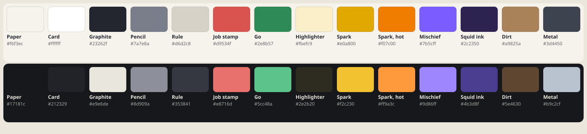

# Art direction

The look of the game (#25): what it should feel like, the palette, the type, and how to
keep new work consistent. The tokens live in `src/styles/tokens.css`; this page says what
they're for.

## The feel: an after-hours field notebook

Rook and Dee run an odd-jobs business for strange problems. They work nights, in
generators, museums and aquariums. The game should feel like their notebook on the job:
warm paper, graphite, a coral stamp on every job, and a little mischief when something
fights back.

Three words: **cozy, mischievous, after-hours.**

**Mood board.** These are references to look at, not to copy:

- **Field notebooks and job ledgers:** off-white paper, ruled lines, pencil-gray notes,
  one strong stamp color. This is the base of every screen.
- **Risograph zines:** flat color, two or three inks, slight overprint. Effects stay flat
  and solid: no gradients for their own sake, no glassy shine.
- **Museum placards and aquarium signage:** big friendly headings, short labels, small
  caps for categories ("CHAPTER 2"). Signs tell you one thing.
- **Night-shift lighting:** the dark theme is a lamp-lit desk, not a terminal. It's warm
  near-black, never pure black.
- **Pixel pictures:** the puzzles are the art. Every solved picture is a crisp 1-bit
  image in graphite. UI never competes with the board.

**What to avoid:**

- Saturated rainbow UI.
- Neon on black.
- Skeuomorphic paper textures behind the board: the grid must stay calm and legible.
- New colors outside the tokens.

## Palette

| Token                     | Name        | Used for                                                             |
| ------------------------- | ----------- | -------------------------------------------------------------------- |
| `--bg`                    | Paper       | The page                                                             |
| `--surface`               | Card        | Cards, the battle bar, panels                                        |
| `--ink`                   | Graphite    | Text, filled cells, pictures                                         |
| `--muted`                 | Pencil      | Secondary text, done clues                                           |
| `--line` / `--guide`      | Rule        | Grid lines, borders; guides every 5 cells                            |
| `--accent`                | Job stamp   | The one action color: Start, the current node, kickers, HP           |
| `--ok`                    | Go          | Your HP, success                                                     |
| `--hl`                    | Highlighter | The row and column under the cursor                                  |
| `--spark` / `--spark-hot` | Spark       | The ⚡ charge meter (#67). Hot once it's three-quarters full         |
| `--mischief`              | Mischief    | The Mimic's swaps (#48): things that move behind your back           |
| `--squid-ink`             | Squid ink   | Inked cells (#67); gray in high contrast so it never reads as filled |
| `--dirt` … `--metal`      | Dig site    | The dig board (#29)                                                  |
| `--shadow`                | Shadow      | The few raised things: the current node, the end panel, sprites      |

**Rules:**

- One accent per screen does the shouting. Mechanic colors only appear on the mechanic
  they belong to.
- Every color has a dark value and a high-contrast value. A new token needs all three.
- No raw hex outside `tokens.css`. `grep -n "#[0-9a-f]\{6\}" src/styles/*.css` should
  only find tokens.

## Type

- **Rubik** (Google Fonts, 400–700), falling back to the system UI font. It's rounded
  enough to feel friendly, and its numerals are clear at clue size.
- **Numbers are tabular** everywhere (`font-variant-numeric: tabular-nums` on the body),
  so clues, timers and HP don't jitter.
- **Headings** are 700 with a hair of letter spacing. **Kickers** ("CHAPTER 3", "ENDLESS")
  are small caps-style: uppercase, 0.75rem, wide tracking, in the accent.
- **Copy** is short and plain, like a sign: one idea per line.

## Characters and sprites

- **Today:** enemies, cast portraits and gadgets are emoji placeholders. They're bold, legible at
  40px, and free.
- **Next step:** replace them with 32×32 pixel sprites drawn in the palette (graphite
  outlines, one accent color each, two at most), so they match the puzzle pictures.
  The prompts for every piece, and the review checklist, are in
  [art/prompts/](art/prompts/README.md).
- Keep each enemy's silhouette tied to its mechanic. The eel is a zigzag, the cuttlefish
  is a blob with trailing ink, the Forger carries a palette.

## Motion

Quick and physical:

- **Pops:** short ones on fills and clue completions.
- **Shakes:** a lunge or flinch on hits.
- **Phase changes:** a single banner.
- **Pacing:** nothing loops forever, and nothing runs longer than about a second.
- **Reduced motion:** with `prefers-reduced-motion`, everything is off and the state
  still changes.
