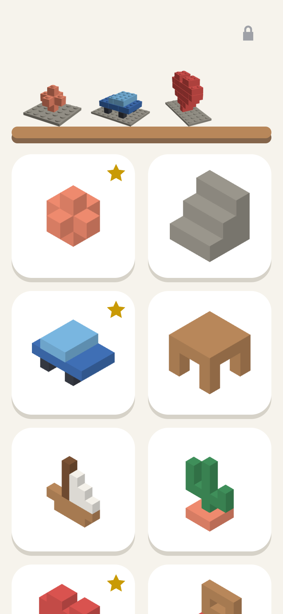
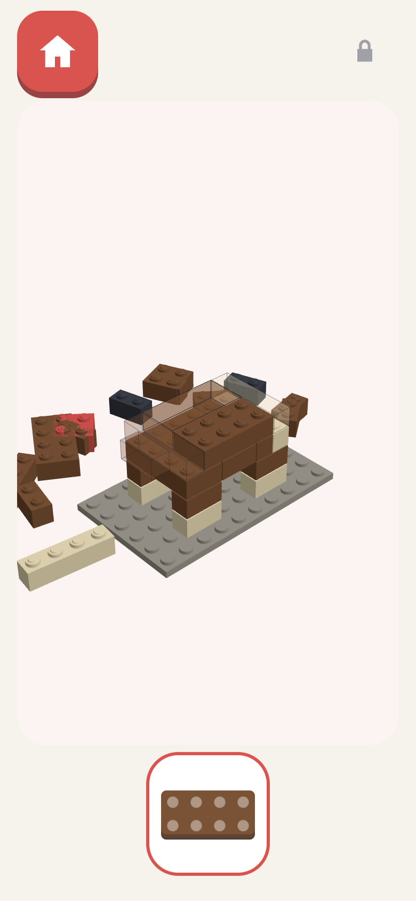
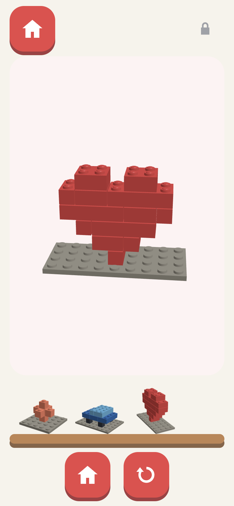

# Brick kids (a prototype)

The build stage ([cubed/build.md](cubed/build.md)) on its own, for kids of about 3 and 4:
pick a toy, and build it from toy bricks, one layer at a time. It's the first version of the
concept in [brick-kids.md](brick-kids.md) (PR #251), on its recommended path: a route in
this app, `#/bricks/…`, to try with real kids before it gets an app of its own. "Brick
kids" is a working title.

## Play it

Start the dev server (`npm run dev`), then Home → **Brick kids**, or:

| What                  | Open                |
| --------------------- | ------------------- |
| The picker and shelf  | `#/bricks`          |
| One build             | `#/bricks/car`      |
| A toy's moment, again | `#/bricks/car/show` |

```bash
npm run dev -- --open '/#/bricks'
```

In dev builds, **N** finishes the current layer, and the console has the build as `__build`
and its view as `__brickView`.

<p>
  
  
  
</p>

## How it plays

Every action is a tap, and nothing needs reading: no counts, no layers, no instructions.
Words are only in the grown-ups' corner and for screen readers.

1. **The picker** is a big picture card for each model, fewest bricks first. A model that's
   been built wears a star. Above them is the **shelf**: every toy built so far.
2. **A build** opens with the pop: the toy shows whole, then flies apart into a pile around
   the plate. The bottom layer's ghost fades in.
3. **The tray** shows every kind of brick the layer still needs, as the build stage's
   does, each drawn turned the way its ghost is, with a dot in its color for each one left
   (a count to see, not read). The buttons wrap at phone width. Tap one to pick it up: its
   ghosts glow and bob.
4. **Tap anywhere on the plate**: the brick flies into the nearest open ghost of its kind,
   turning itself on the way if it has to. It stays in hand while there are more of that
   kind; when there aren't, tap another. Dragging works too, but is never needed. There's no Turn button, no R key, and no way to miss.
5. **A layer done** plays a little tune, and the camera rises to the next. The camera looks
   after itself: it sways a little on its own, with no orbit or zoom.
6. **The toy done** turns on its plate, hops and bursts, with a longer tune. Then a picture
   of it drops onto the shelf, with Home and Build it again.
7. **On the shelf**, tapping a toy plays its moment again: it turns, hops and bursts. Tap it
   for more.

A build left partway picks up on the layer it was on. Each brick pops a note higher through
a layer (a major pentatonic, so any run of them sounds happy); a tap with nothing in hand
wiggles the tray's brick with a soft boing, never a buzz.

**The grown-ups' corner** is the small lock at the top right. It opens only when held for
three seconds (a ring fills as you hold), so a tapping child doesn't land in it. Inside:
sound on or off (the app's own setting), **Start over** in a build or **Clear the shelf** on
the picker (each asks once more), and the way out to the main menu, which the kids' screens
have no other link to.

## The models

37 in all, fewest bricks first in the picker:

- **Its own 26** (`packages/block/src/puzzles/bricks/`, loaded by `bricks.ts`): animals
  (duck, hen, sheep, bunny, piglet, frog, honeybee, garden-snail, crab, whale, elephant,
  penguin, teddy), things that go (airplane, tugboat, fire-truck, digger, train, bus,
  tractor) and things kids know (ice-pop, daisy-pot, rainbow, birthday-cake, cottage,
  apple-tree). Made for building, not nonograms: no hidden clues, and out of free play and
  the dailies. Each is at most 8 cubes a side, five colors and 8 layers, and 7 to 33 bricks.
  Their ids are their own, never a pack, story or trio id (`build/models.test.ts`), and
  `buildModel` finds them, so `#/cubed/build/<id>` opens them too. They're toys, not
  puzzles: nothing offers them to carve (`#/cubed/trio/<id>` takes only trio and pack
  puzzles), since their clues are never checked. The build camera sees
  the front and the left, so faces and details go there.
- **The Cubed pack's ten** that split into 20 bricks or fewer (jack, steps, car, table,
  sailboat, cactus, heart, chair, mushroom, wheelbarrow), read through `buildModel`, not
  copies.
- **The trio's dog** (26).

`models.test.ts` checks every one is there, stays small, is in order, and builds by taps.

## The code

| What                     | Where                                                                       |
| ------------------------ | --------------------------------------------------------------------------- |
| Its routes               | `apps/picross/src/bricks/routes.ts`, loaded by `src/routes.ts` (`import()`) |
| The picker and the shelf | `src/bricks/ui/picker.ts` (no three.js)                                     |
| A build, a toy's moment  | `src/bricks/ui/build.ts` (three.js, loaded with `import()`)                 |
| The grown-ups' corner    | `src/bricks/ui/gate.ts`                                                     |
| Models and rules         | `src/bricks/models.ts` (`BRICKS_MODELS`, `KIDS_RULES`)                      |
| The save                 | `src/bricks/shelf.ts` (`picross:bricks`, on this device only)               |
| Sounds                   | `src/bricks/sounds.ts`, on shared's `playNotes`                             |
| Styles                   | `src/bricks/styles/bricks.css`                                              |
| The build's rules        | `BuildRules` in `packages/block/src/build/build.ts`                         |
| Where models come from   | `buildModel` and `BrickModel` in `packages/block/src/build/models.ts`       |
| The view's extras        | `BrickViewOptions` in `packages/play-block/src/ui/board/brickView.ts`       |
| Carrying from the tray   | `carryFromTray` in `packages/play-block/src/ui/board/brickInput.ts`         |

The kids' version is options on the build stage's code, not a fork of it. `BrickBuild`
takes `BuildRules`: `reach` (how far a drop can be from a ghost; `Infinity` here), `anyTurn`
(a brick fits either way round) and `oneKind` (the tray offers only the biggest kind left;
not used here, kept for a younger setting).
`BrickView` takes `drift` (the camera sways) and `bob` (lit ghosts pulse and bob),
`placed()` takes where the brick flew from, and `celebrate()` takes `middle` and `hops`.
Left out, each behaves as it always has, so Cubed's build stage is unchanged; its tests
and `e2e/cubed/build.spec.ts` check that. Distance to a ghost is now measured between the
brick's middle and the ghost's (the same as before for bricks turned alike), and a tie on
grid steps goes to the nearer ghost.

The route's folder follows Cubed's rules: only `src/routes.ts` reaches it, with one
`import()` (lint checks), and `npm run check:budget` checks it's a lazy chunk of its own
with no three.js. Its tests are next to the code (`*.test.ts`) and in
`apps/picross/e2e/bricks.spec.ts`.

Bricks are generic toy bricks with this game's own stud. No toy brand's name, look,
colors or packaging; no ads, accounts, links out or tracking.

## Left for later

The concept's open questions, still open: free building on an empty plate, a voice, more
models made for kids, chunky versions of big pack models, a toy that comes to life in its
own way (a dog that wags, a car that drives), an older kids' setting (a shorter reach,
turning by hand) or a younger one (one kind at a time, `oneKind`), a tablet-first layout, and an app of its own (`apps/bricks`).
